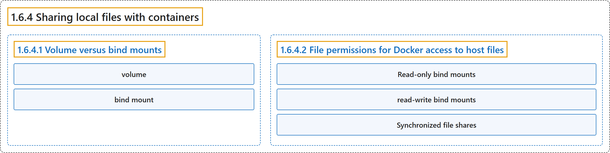

# 1.6.4 Sharing local files with containers

## Classification

## Glossary

| Term | Definition | 中文翻译 | Source |
|---|---|---|---|
| **1.6.4 Sharing local files with containers** 与容器共享本地文件 | (context) "Docker offers **two primary storage options** for persisting data and sharing files between the host machine and containers: **volumes and bind mounts**." | （语境）Docker 提供**两种主要的存储方式**，用于持久保存数据以及在主机和容器之间共享文件：**卷和绑定挂载**。 | [Docker Inc., n.d., "Explanation", para. 3](https://docs.docker.com/get-started/docker-concepts/running-containers/sharing-local-files/#:~:text=Docker%20offers%20two%20primary%20storage%20options%20for) |
| **1.6.4.1 Volume versus bind mounts** 卷与绑定挂载 | (No definition) | （无定义） | [Docker Inc., n.d., "Volume versus bind mounts"](https://docs.docker.com/get-started/docker-concepts/running-containers/sharing-local-files/#volume-versus-bind-mounts) |
| **volume** 卷 | "If you want to ensure that **data generated or modified inside the container** persists **even after the container stops running**, you would opt for **a volume**." | 如果你想确保**容器内生成或修改的数据**保留到**容器停止运行之后**，就选用**卷**。 | [Docker Inc., n.d., "Volume versus bind mounts", para. 1](https://docs.docker.com/get-started/docker-concepts/running-containers/sharing-local-files/#:~:text=If%20you%20want%20to%20ensure%20that%20data) |
| **bind mount** 绑定挂载 | "If you have **specific files or directories on your host system** that you want to **directly share with your container**, like configuration files or development code, then you would use **a bind mount**." | 如果你有**主机系统上的特定文件或目录**，想要**直接与容器共享**，例如配置文件或开发代码，就使用**绑定挂载**。 | [Docker Inc., n.d., "Volume versus bind mounts", para. 2](https://docs.docker.com/get-started/docker-concepts/running-containers/sharing-local-files/#:~:text=If%20you%20have%20specific%20files%20or%20directories) |
| **1.6.4.2 File permissions for Docker access to host files** Docker 访问主机文件的权限 | "When **using bind mounts**, it's crucial to ensure that **Docker has the necessary permissions** to **access the host directory**." | **使用绑定挂载**时，关键是确保 **Docker 拥有所需的权限**来**访问主机目录**。 | [Docker Inc., n.d., "File permissions for Docker access to host files", para. 1](https://docs.docker.com/get-started/docker-concepts/running-containers/sharing-local-files/#:~:text=When%20using%20bind%20mounts%2C%20it%27s%20crucial%20to) |
| **Read-only bind mounts** 只读绑定挂载 | "Read-only bind mounts let the container **access the mounted files on the host for reading**, but it **can't change or delete the files**." | 只读绑定挂载让容器**可以读取主机上挂载的文件**，但**不能修改或删除这些文件**。 | [Docker Inc., n.d., "File permissions for Docker access to host files", para. 2](https://docs.docker.com/get-started/docker-concepts/running-containers/sharing-local-files/#:~:text=Read-only%20bind%20mounts%20let%20the%20container%20access) |
| **read-write bind mounts** 读写绑定挂载 | "With read-write bind mounts, **containers can modify or delete mounted files**, and these changes or deletions will **also be reflected on the host system**." | 使用读写绑定挂载时，**容器可以修改或删除挂载的文件**，这些修改或删除**也会反映到主机系统上**。 | [Docker Inc., n.d., "File permissions for Docker access to host files", para. 2](https://docs.docker.com/get-started/docker-concepts/running-containers/sharing-local-files/#:~:text=With%20read-write%20bind%20mounts%2C%20containers%20can%20modify) |
| **Synchronized file shares** 同步文件共享 | "Synchronized file shares **improve bind mount performance** by leveraging **synchronized filesystem caches**." | 同步文件共享**提升绑定挂载的性能**，方法是利用**同步的文件系统缓存**。 | [Docker Inc., n.d., "File permissions for Docker access to host files", para. 4](https://docs.docker.com/get-started/docker-concepts/running-containers/sharing-local-files/#:~:text=%5BSynchronized%20file%20shares%5D%28https%3A%2F%2Fdocs.docker.com%2Fdesktop%2Ffeatures%2Fsynchronized-file-sharing%2F%29%20improve%20bind%20mount%20performance) |

## References

Docker Inc. (n.d.). *Sharing local files with containers*. Docker Docs. Retrieved October 31, 2026, from <https://docs.docker.com/get-started/docker-concepts/running-containers/sharing-local-files/>
