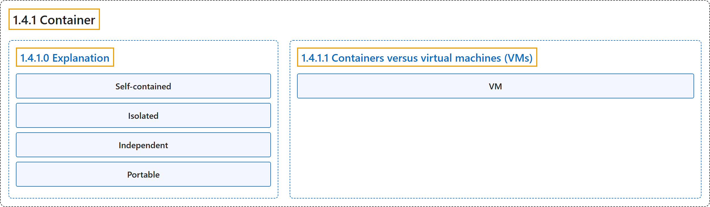

# 1.4.1 Container

## Classification

## Glossary

| Term | Definition | 中文翻译 | Source |
|---|---|---|---|
| **1.4.1 Container** 容器 | "Simply put, containers are **isolated processes** for **each of your app's components**." | 简单地说，容器是**隔离的进程**，对应**应用的每个组件**。 | [Docker Inc., n.d., "Explanation", para. 5](https://docs.docker.com/get-started/docker-concepts/the-basics/what-is-a-container/#:~:text=Simply%20put%2C%20containers%20are%20isolated%20processes%20for) |
| **1.4.1.0 Explanation** 说明 | (No definition) | （无定义） | [Docker Inc., n.d., "Explanation"](https://docs.docker.com/get-started/docker-concepts/the-basics/what-is-a-container/#explanation) |
| **Self-contained** 自包含 | "Self-contained. **Each container has everything it needs to function** with **no reliance on any pre-installed dependencies on the host machine**." | 自包含。**每个容器都拥有运行所需的一切**，因而**不依赖主机上预装的任何依赖项**。 | [Docker Inc., n.d., "Explanation", para. 7](https://docs.docker.com/get-started/docker-concepts/the-basics/what-is-a-container/#:~:text=Self-contained.%20Each%20container%20has%20everything%20it%20needs) |
| **Isolated** 隔离 | "Isolated. Since **containers run in isolation**, they have **minimal influence on the host and other containers**, increasing **the security of your applications**." | 隔离。由于**容器在隔离中运行**，它们对**主机和其他容器的影响极小**，从而提高**应用的安全性**。 | [Docker Inc., n.d., "Explanation", para. 8](https://docs.docker.com/get-started/docker-concepts/the-basics/what-is-a-container/#:~:text=Isolated.%20Since%20containers%20run%20in%20isolation%2C%20they) |
| **Independent** 独立 | "Independent. **Each container** is **independently managed**." | 独立。**每个容器**都被**独立管理**。 | [Docker Inc., n.d., "Explanation", para. 9](https://docs.docker.com/get-started/docker-concepts/the-basics/what-is-a-container/#:~:text=Independent.%20Each%20container%20is%20independently%20managed.) |
| **Portable** 可移植 | "Portable. **Containers** can **run anywhere**!" | 可移植。**容器**可以**在任何地方运行**！ | [Docker Inc., n.d., "Explanation", para. 10](https://docs.docker.com/get-started/docker-concepts/the-basics/what-is-a-container/#:~:text=Portable.%20Containers%20can%20run%20anywhere%21) |
| **1.4.1.1 Containers versus virtual machines (VMs)** 容器与虚拟机（VM） | "A container is **simply an isolated process** with **all of the files it needs to run**." | 容器**只是一个隔离进程**，带有**运行所需的全部文件**。 | [Docker Inc., n.d., "Containers versus virtual machines (VMs)", para. 2](https://docs.docker.com/get-started/docker-concepts/the-basics/what-is-a-container/#:~:text=A%20container%20is%20simply%20an%20isolated%20process) |
| **VM** 虚拟机 | "Without getting too deep, a VM is **an entire operating system** with **its own kernel, hardware drivers, programs, and applications**." | 不深入细节地说，虚拟机是**一个完整的操作系统**，拥有**自己的内核、硬件驱动、程序和应用**。 | [Docker Inc., n.d., "Containers versus virtual machines (VMs)", para. 1](https://docs.docker.com/get-started/docker-concepts/the-basics/what-is-a-container/#:~:text=Without%20getting%20too%20deep%2C%20a%20VM%20is) |

## References

Docker Inc. (n.d.). *What is a container?* Docker Docs. Retrieved October 31, 2026, from <https://docs.docker.com/get-started/docker-concepts/the-basics/what-is-a-container/>
