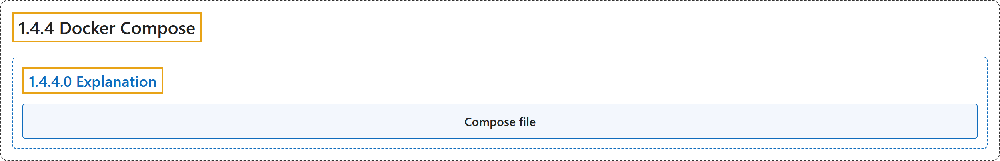

# 1.4.4 Docker Compose

## Classification

## Glossary

| Term | Definition | 中文翻译 | Source |
|---|---|---|---|
| **1.4.4 Docker Compose** Docker Compose | "With Docker Compose, you can **define all of your containers and their configurations** in **a single YAML file**." | 使用 Docker Compose，你可以**定义所有容器及其配置**，放在**单个 YAML 文件**中。 | [Docker Inc., n.d., "Explanation", para. 4](https://docs.docker.com/get-started/docker-concepts/the-basics/what-is-docker-compose/#:~:text=With%20Docker%20Compose%2C%20you%20can%20define%20all) |
| **1.4.4.0 Explanation** 说明 | (No definition) | （无定义） | [Docker Inc., n.d., "Explanation"](https://docs.docker.com/get-started/docker-concepts/the-basics/what-is-docker-compose/#explanation) |
| **Compose file** Compose 文件 | "**A Dockerfile provides instructions to build a container image** while **a Compose file defines your running containers**." | **Dockerfile 提供构建容器镜像的指令**，而 **Compose 文件定义你运行的容器**。 | [Docker Inc., n.d., "Explanation", para. 7](https://docs.docker.com/get-started/docker-concepts/the-basics/what-is-docker-compose/#:~:text=A%20Dockerfile%20provides%20instructions%20to%20build%20a) |

## References

Docker Inc. (n.d.). *What is Docker Compose?* Docker Docs. Retrieved October 31, 2026, from <https://docs.docker.com/get-started/docker-concepts/the-basics/what-is-docker-compose/>
