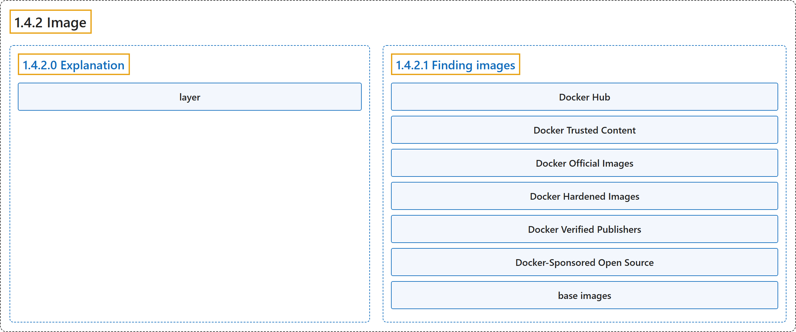

# 1.4.2 Image

## Classification

## Glossary

| Term | Definition | 中文翻译 | Source |
|---|---|---|---|
| **1.4.2 Image** 镜像 | "A container image is **a standardized package** that includes **all of the files, binaries, libraries, and configurations** to **run a container**." | 容器镜像是**一个标准化的包**，包含**全部文件、二进制文件、库和配置**，用于**运行一个容器**。 | [Docker Inc., n.d., "Explanation", para. 2](https://docs.docker.com/get-started/docker-concepts/the-basics/what-is-an-image/#:~:text=A%20container%20image%20is%20a%20standardized%20package) |
| **1.4.2.0 Explanation** 说明 | (No definition) | （无定义） | [Docker Inc., n.d., "Explanation"](https://docs.docker.com/get-started/docker-concepts/the-basics/what-is-an-image/#explanation) |
| **layer** 层 | "Container images are composed of layers. **Each layer** represents **a set of file system changes** that **add, remove, or modify files**." | 容器镜像由层组成。**每一层**代表**一组文件系统变更**，用于**新增、删除或修改文件**。 | [Docker Inc., n.d., "Explanation", para. 6](https://docs.docker.com/get-started/docker-concepts/the-basics/what-is-an-image/#:~:text=Container%20images%20are%20composed%20of%20layers.%20Each) |
| **1.4.2.1 Finding images** 查找镜像 | (No definition) | （无定义） | [Docker Inc., n.d., "Finding images"](https://docs.docker.com/get-started/docker-concepts/the-basics/what-is-an-image/#finding-images) |
| **Docker Hub** Docker Hub | "Docker Hub is **the default global marketplace** for **storing and distributing images**." | Docker Hub 是**默认的全球市场**，用于**存储和分发镜像**。 | [Docker Inc., n.d., "Finding images", para. 1](https://docs.docker.com/get-started/docker-concepts/the-basics/what-is-an-image/#:~:text=%5BDocker%20Hub%5D%28https%3A%2F%2Fhub.docker.com%29%20is%20the%20default%20global%20marketplace) |
| **Docker Trusted Content** Docker 可信内容 | "Docker Hub provides **a variety of Docker-supported and endorsed images** known as **Docker Trusted Content**." | Docker Hub 提供**多种由 Docker 支持和认可的镜像**，称为 **Docker 可信内容**。 | [Docker Inc., n.d., "Finding images", para. 2](https://docs.docker.com/get-started/docker-concepts/the-basics/what-is-an-image/#:~:text=Docker%20Hub%20provides%20a%20variety%20of%20Docker-supported) |
| **Docker Official Images** Docker 官方镜像 | "Docker Official Images - **a curated set of Docker repositories**, serve as **the starting point for the majority of users**, and are **some of the most secure on Docker Hub**" | Docker 官方镜像：**一组精选的 Docker 仓库**，是**大多数用户的起点**，也是 **Docker Hub 上最安全的镜像之一** | [Docker Inc., n.d., "Finding images", para. 3](https://docs.docker.com/get-started/docker-concepts/the-basics/what-is-an-image/#:~:text=%5BDocker%20Official%20Images%5D%28https%3A%2F%2Fhub.docker.com%2Fsearch%3Fbadges%3Dofficial%29%20-%20a%20curated%20set) |
| **Docker Hardened Images** Docker 加固镜像 | "Docker Hardened Images - **minimal, secure, production-ready images** with **near-zero CVEs**, designed to **reduce attack surface and simplify compliance**." | Docker 加固镜像：**精简、安全、可用于生产的镜像**，其 **CVE 近乎为零**，旨在**缩小攻击面、简化合规**。 | [Docker Inc., n.d., "Finding images", para. 4](https://docs.docker.com/get-started/docker-concepts/the-basics/what-is-an-image/#:~:text=%5BDocker%20Hardened%20Images%5D%28https%3A%2F%2Fhub.docker.com%2Fhardened-images%2Fcatalog%29%20-%20minimal%2C%20secure%2C%20production-ready) |
| **Docker Verified Publishers** Docker 认证发布者 | "Docker Verified Publishers - **high-quality images** from **commercial publishers verified by Docker**" | Docker 认证发布者：**高质量镜像**，来自**经 Docker 认证的商业发布者** | [Docker Inc., n.d., "Finding images", para. 5](https://docs.docker.com/get-started/docker-concepts/the-basics/what-is-an-image/#:~:text=%5BDocker%20Verified%20Publishers%5D%28https%3A%2F%2Fhub.docker.com%2Fsearch%3Fbadges%3Dverified_publisher%29%20-%20high-quality%20images%20from) |
| **Docker-Sponsored Open Source** Docker 赞助的开源项目 | "Docker-Sponsored Open Source - **images published and maintained** by **open-source projects sponsored by Docker** through **Docker's open source program**" | Docker 赞助的开源项目：**发布和维护的镜像**，来自**由 Docker 赞助的开源项目**，通过 **Docker 的开源计划** | [Docker Inc., n.d., "Finding images", para. 6](https://docs.docker.com/get-started/docker-concepts/the-basics/what-is-an-image/#:~:text=%5BDocker-Sponsored%20Open%20Source%5D%28https%3A%2F%2Fhub.docker.com%2Fsearch%3Fbadges%3Dopen_source%29%20-%20images%20published%20and) |
| **base images** 基础镜像 | "There are also **base images**, like the Node.js Docker image, that you can **use as a starting point** and **add your own files and configurations**." | 还有一些**基础镜像**，例如 Node.js Docker 镜像，你可以**把它作为起点**，再**加入自己的文件和配置**。 | [Docker Inc., n.d., "Finding images", para. 7](https://docs.docker.com/get-started/docker-concepts/the-basics/what-is-an-image/#:~:text=There%20are%20also%20base%20images%2C%20like%20the) |

## References

Docker Inc. (n.d.). *What is an image?* Docker Docs. Retrieved October 31, 2026, from <https://docs.docker.com/get-started/docker-concepts/the-basics/what-is-an-image/>
