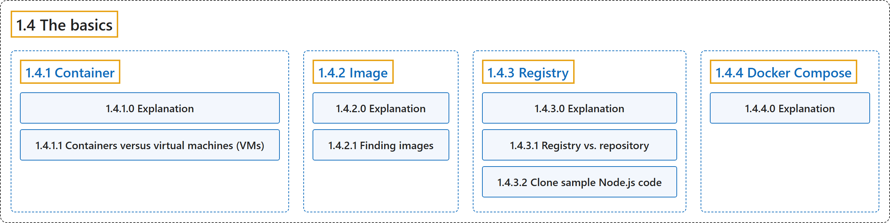

# 1.4 The basics

## Classification

## Glossary

| Term | Definition | 中文翻译 | Source |
|---|---|---|---|
| **1.4 The basics** 基础 | (No definition) | （无定义） | [Docker Inc., n.d.-a, "The basics", documentation menu](https://docs.docker.com/get-started/) |
| **[1.4.1 Container](container.md)** 容器 | "Simply put, containers are **isolated processes for each of your app's components**." | 简单地说，容器是**为应用的每个组件各自隔离的进程**。 | [Docker Inc., n.d.-b, "Explanation", para. 5](https://docs.docker.com/get-started/docker-concepts/the-basics/what-is-a-container/#:~:text=Simply%20put%2C%20containers%20are%20isolated%20processes%20for) |
| **[1.4.2 Image](image.md)** 镜像 | "A container image is **a standardized package that includes all of the files, binaries, libraries, and configurations to run a container**." | 容器镜像是**一个标准化的包，包含运行一个容器所需的全部文件、二进制文件、库和配置**。 | [Docker Inc., n.d.-d, "Explanation", para. 2](https://docs.docker.com/get-started/docker-concepts/the-basics/what-is-an-image/#:~:text=A%20container%20image%20is%20a%20standardized%20package) |
| **[1.4.3 Registry](registry.md)** 注册表 | "An image registry is **a centralized location for storing and sharing your container images**." | 镜像注册表是**一个用于存储和共享容器镜像的集中位置**。 | [Docker Inc., n.d.-c, "Explanation", para. 3](https://docs.docker.com/get-started/docker-concepts/the-basics/what-is-a-registry/#:~:text=An%20image%20registry%20is%20a%20centralized%20location) |
| **[1.4.4 Docker Compose](docker-compose.md)** Docker Compose | "With Docker Compose, you can **define all of your containers and their configurations in a single YAML file**." | 使用 Docker Compose，你可以**在单个 YAML 文件中定义所有容器及其配置**。 | [Docker Inc., n.d.-e, "Explanation", para. 4](https://docs.docker.com/get-started/docker-concepts/the-basics/what-is-docker-compose/#:~:text=With%20Docker%20Compose%2C%20you%20can%20define%20all) |

## References

Docker Inc. (n.d.-a). *Get started*. Docker Docs. Retrieved October 31, 2026, from <https://docs.docker.com/get-started/>

Docker Inc. (n.d.-b). *What is a container?* Docker Docs. Retrieved October 31, 2026, from <https://docs.docker.com/get-started/docker-concepts/the-basics/what-is-a-container/>

Docker Inc. (n.d.-c). *What is a registry?* Docker Docs. Retrieved October 31, 2026, from <https://docs.docker.com/get-started/docker-concepts/the-basics/what-is-a-registry/>

Docker Inc. (n.d.-d). *What is an image?* Docker Docs. Retrieved October 31, 2026, from <https://docs.docker.com/get-started/docker-concepts/the-basics/what-is-an-image/>

Docker Inc. (n.d.-e). *What is Docker Compose?* Docker Docs. Retrieved October 31, 2026, from <https://docs.docker.com/get-started/docker-concepts/the-basics/what-is-docker-compose/>
