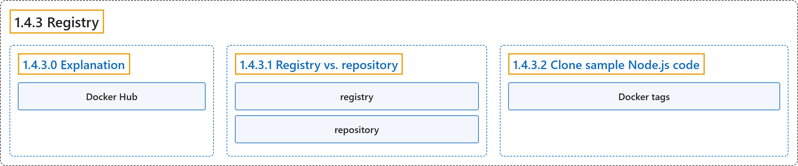

# 1.4.3 Registry

## Classification

## Glossary

| Term | Definition | 中文翻译 | Source |
|---|---|---|---|
| **1.4.3 Registry** 注册表 | "An image registry is **a centralized location for storing and sharing your container images**." | 镜像注册表是**一个用于存储和共享容器镜像的集中位置**。 | [Docker Inc., n.d., "Explanation", para. 3](https://docs.docker.com/get-started/docker-concepts/the-basics/what-is-a-registry/#:~:text=An%20image%20registry%20is%20a%20centralized%20location) |
| **1.4.3.0 Explanation** 说明 | (No definition) | （无定义） | [Docker Inc., n.d., "Explanation"](https://docs.docker.com/get-started/docker-concepts/the-basics/what-is-a-registry/#explanation) |
| **Docker Hub** Docker Hub | "[Docker Hub](https://hub.docker.com) is **a public registry that anyone can use and is the default registry**." | [Docker Hub](https://hub.docker.com) 是**一个任何人都可以使用的公共注册表，也是默认的注册表**。 | [Docker Inc., n.d., "Explanation", para. 3](https://docs.docker.com/get-started/docker-concepts/the-basics/what-is-a-registry/#:~:text=%5BDocker%20Hub%5D%28https%3A%2F%2Fhub.docker.com%29%20is%20a%20public%20registry%20that) |
| **1.4.3.1 Registry vs. repository** 注册表与仓库 | (context) "Even though they're related, **they're not quite the same thing**." | （语境）尽管二者相关，**它们并不完全是一回事**。 | [Docker Inc., n.d., "Registry vs. repository", para. 1](https://docs.docker.com/get-started/docker-concepts/the-basics/what-is-a-registry/#:~:text=Even%20though%20they%27re%20related%2C%20they%27re%20not%20quite) |
| **registry** 注册表 | "A *registry* is **a centralized location that stores and manages container images**, whereas a *repository* is a collection of related container images within a registry." | *注册表*是**一个存储和管理容器镜像的集中位置**，而*仓库*是注册表中一组相关的容器镜像。 | [Docker Inc., n.d., "Registry vs. repository", para. 2](https://docs.docker.com/get-started/docker-concepts/the-basics/what-is-a-registry/#:~:text=A%20%2Aregistry%2A%20is%20a%20centralized%20location%20that) |
| **repository** 仓库 | "A *registry* is a centralized location that stores and manages container images, whereas a *repository* is **a collection of related container images within a registry**." | *注册表*是一个存储和管理容器镜像的集中位置，而*仓库*是**注册表中一组相关的容器镜像**。 | [Docker Inc., n.d., "Registry vs. repository", para. 2](https://docs.docker.com/get-started/docker-concepts/the-basics/what-is-a-registry/#:~:text=A%20%2Aregistry%2A%20is%20a%20centralized%20location%20that) |
| **1.4.3.2 Clone sample Node.js code** 克隆 Node.js 示例代码 | (No definition) | （无定义） | [Docker Inc., n.d., "Clone sample Node.js code"](https://docs.docker.com/get-started/docker-concepts/the-basics/what-is-a-registry/#clone-sample-nodejs-code) |
| **Docker tags** Docker 标签 | "Docker tags **allow you to label and version your images**." | Docker 标签**让你为镜像加标签并标注版本**。 | [Docker Inc., n.d., "Clone sample Node.js code", para. 8](https://docs.docker.com/get-started/docker-concepts/the-basics/what-is-a-registry/#:~:text=Docker%20tags%20allow%20you%20to%20label%20and) |

## References

Docker Inc. (n.d.). *What is a registry?* Docker Docs. Retrieved October 31, 2026, from <https://docs.docker.com/get-started/docker-concepts/the-basics/what-is-a-registry/>
