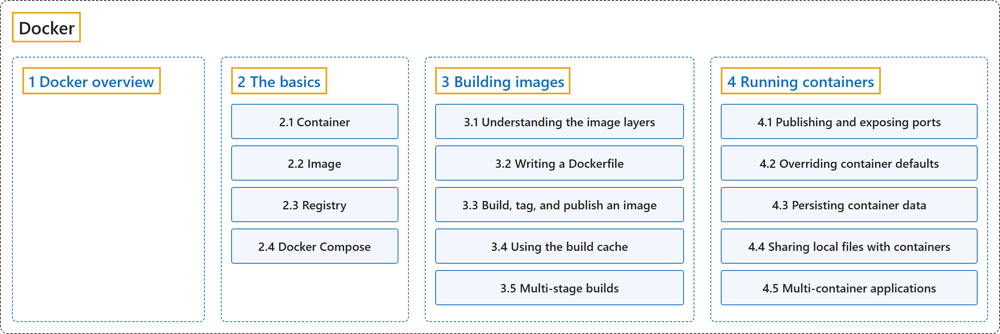

# Docker

## Classification

## Glossary

| Term | Definition | 中文翻译 | Source |
|---|---|---|---|
| **Docker** Docker | "Docker is **an open platform for developing, shipping, and running applications**." | Docker 是**一个用于开发、交付和运行应用程序的开放平台**。 | [Docker Inc., n.d.-c, "What is Docker?", para. 1](https://docs.docker.com/get-started/docker-overview/#:~:text=Docker%20is%20an%20open%20platform%20for%20developing%2C) |
| **[1 Docker overview](docker-overview.md)** Docker 概述 | (context) "Docker enables you to **separate your applications from your infrastructure so you can deliver software quickly**." | （语境）Docker 让你能够**把应用程序与基础设施分离，从而快速交付软件**。 | [Docker Inc., n.d.-c, "What is Docker?", para. 1](https://docs.docker.com/get-started/docker-overview/#:~:text=Docker%20enables%20you%20to%20separate%20your%20applications) |
| **[2 The basics](the-basics/index.md)** 基础 | (No definition) | （无定义） | [Docker Inc., n.d.-b, "The basics", documentation menu](https://docs.docker.com/get-started/) |
| **[3 Building images](building-images/index.md)** 构建镜像 | (context) "Learn how to **build production-ready images that are lean and efficient Docker images**, essential for minimizing overhead and enhancing deployment in production environments." | （语境）学习如何**构建可用于生产、精简高效的 Docker 镜像**，这对减少开销、改进生产环境中的部署至关重要。 | [Docker Inc., n.d.-a, "About this series", para. 1](https://docs.docker.com/get-started/docker-concepts/building-images/#:~:text=Learn%20how%20to%20build%20production-ready%20images%20that) |
| **[4 Running containers](running-containers/index.md)** 运行容器 | (No definition) | （无定义） | [Docker Inc., n.d.-b, "Running containers", documentation menu](https://docs.docker.com/get-started/) |

## References

Docker Inc. (n.d.-a). *Building images*. Docker Docs. Retrieved October 31, 2026, from <https://docs.docker.com/get-started/docker-concepts/building-images/>

Docker Inc. (n.d.-b). *Get started*. Docker Docs. Retrieved October 31, 2026, from <https://docs.docker.com/get-started/>

Docker Inc. (n.d.-c). *What is Docker?* Docker Docs. Retrieved October 31, 2026, from <https://docs.docker.com/get-started/docker-overview/>
