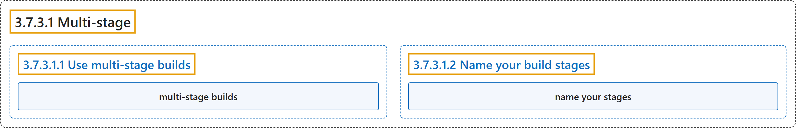

# 3.7.3.1 Multi-stage

## Classification

## Glossary

| Term | Definition | 中文翻译 | Source |
|---|---|---|---|
| **3.7.3.1 Multi-stage** 多阶段构建 | (No definition) | （无定义） | [Docker Inc., n.d., "Multi-stage", documentation menu](https://docs.docker.com/build/building/multi-stage/) |
| **3.7.3.1.1 Use multi-stage builds** Use multi-stage builds | (No definition) | （无定义） | [Docker Inc., n.d., "Use multi-stage builds", documentation menu](https://docs.docker.com/build/building/multi-stage/) |
| **`multi-stage builds`** 多阶段构建 | "With multi-stage builds, you **use multiple `FROM` statements in your Dockerfile**." | 使用多阶段构建时，你**在 Dockerfile 中使用多条 `FROM` 语句**。 | [Docker Inc., n.d., "Use multi-stage builds", para. 1](https://docs.docker.com/build/building/multi-stage/#:~:text=With%20multi-stage%20builds%2C%20you%20use%20multiple%20%60FROM%60%20statements) |
| **3.7.3.1.2 Name your build stages** Name your build stages | (No definition) | （无定义） | [Docker Inc., n.d., "Name your build stages", documentation menu](https://docs.docker.com/build/building/multi-stage/) |
| **name your stages** 命名构建阶段 | "However, you can **name your stages, by adding an `AS <NAME>` to the `FROM` instruction**." | 不过，你可以**通过在 `FROM` 指令后加 `AS <NAME>` 来命名各阶段**。 | [Docker Inc., n.d., "Name your build stages", para. 1](https://docs.docker.com/build/building/multi-stage/#:~:text=However%2C%20you%20can%20name%20your%20stages%2C%20by%20adding) |

## References

Docker Inc. (n.d.). *Multi-stage*. Docker Docs. Retrieved November 2, 2026, from <https://docs.docker.com/build/building/multi-stage/>
