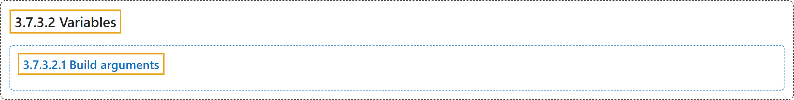

# 3.7.3.2 Variables

## Classification

## Glossary

| Term | Definition | 中文翻译 | Source |
|---|---|---|---|
| **3.7.3.2 Variables** 变量 | (No definition) | （无定义） | [Docker Inc., n.d., "Variables", documentation menu](https://docs.docker.com/build/building/variables/) |
| **3.7.3.2.1 Build arguments** 构建参数 | "**Build arguments** are **variables for the Dockerfile itself**." | **构建参数**是 **Dockerfile 自身的变量**。 | [Docker Inc., n.d., "Build arguments", para. 1](https://docs.docker.com/build/building/variables/#:~:text=Build%20arguments%20are%20variables%20for%20the%20Dockerfile%20itself.) |

## References

Docker Inc. (n.d.). *Variables*. Docker Docs. Retrieved November 2, 2026, from <https://docs.docker.com/build/building/variables/>
