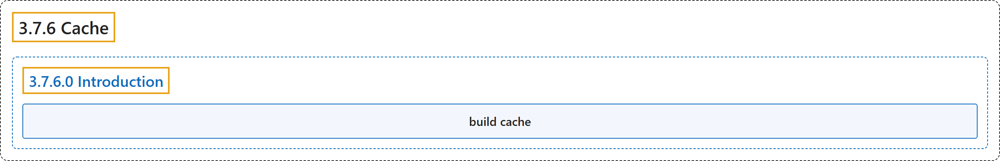

# 3.7.6 Cache

## Classification

## Glossary

| Term | Definition | 中文翻译 | Source |
|---|---|---|---|
| **3.7.6 Cache** 构建缓存 | (No definition) | （无定义） | [Docker Inc., n.d., "Cache", documentation menu](https://docs.docker.com/build/cache/) |
| **3.7.6.0 Introduction** 简介 | (No definition) | （无定义） | [Docker Inc., n.d., "Docker build cache", opening](https://docs.docker.com/build/cache/) |
| **build cache** 构建缓存 | (context) "When you build the same Docker image multiple times, knowing how to optimize the **build cache** is a great tool for making sure the builds run fast." | （语境）多次构建同一个 Docker 镜像时，懂得优化**构建缓存**是让构建变快的好办法。 | [Docker Inc., n.d., "Docker build cache", para. 1](https://docs.docker.com/build/cache/#:~:text=When%20you%20build%20the%20same%20Docker%20image%20multiple) |

## References

Docker Inc. (n.d.). *Cache*. Docker Docs. Retrieved November 2, 2026, from <https://docs.docker.com/build/cache/>
