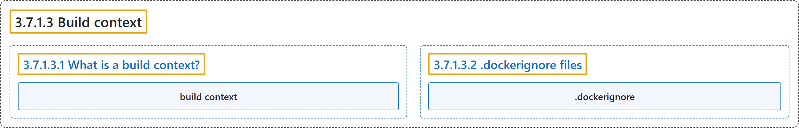

# 3.7.1.3 Build context

## Classification

## Glossary

| Term | Definition | 中文翻译 | Source |
|---|---|---|---|
| **3.7.1.3 Build context** 构建上下文 | (No definition) | （无定义） | [Docker Inc., n.d., "Build context", documentation menu](https://docs.docker.com/build/concepts/context/) |
| **3.7.1.3.1 What is a build context?** What is a build context? | (No definition) | （无定义） | [Docker Inc., n.d., "What is a build context?", documentation menu](https://docs.docker.com/build/concepts/context/) |
| **build context** 构建上下文 | "**The build context** is **the set of files that your build can access**." | **构建上下文**是**你的构建可以访问的文件集合**。 | [Docker Inc., n.d., "What is a build context?", para. 1](https://docs.docker.com/build/concepts/context/#:~:text=The%20build%20context%20is%20the%20set%20of%20files) |
| **3.7.1.3.2 .dockerignore files** .dockerignore files | (No definition) | （无定义） | [Docker Inc., n.d., ".dockerignore files", documentation menu](https://docs.docker.com/build/concepts/context/) |
| **`.dockerignore`** .dockerignore 文件 | "You can use a **`.dockerignore` file** to **exclude files or directories from the build context**." | 你可以用 **`.dockerignore` 文件**来**把文件或目录排除在构建上下文之外**。 | [Docker Inc., n.d., ".dockerignore files", para. 1](https://docs.docker.com/build/concepts/context/#:~:text=You%20can%20use%20a%20%60.dockerignore%60%20file%20to%20exclude) |

## References

Docker Inc. (n.d.). *Build context*. Docker Docs. Retrieved November 2, 2026, from <https://docs.docker.com/build/concepts/context/>
