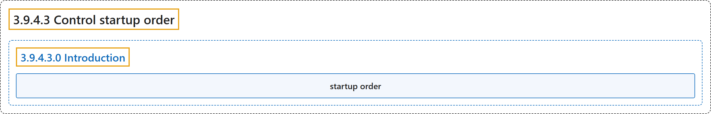

# 3.9.4.3 Control startup order

## Classification

## Glossary

| Term | Definition | 中文翻译 | Source |
|---|---|---|---|
| **3.9.4.3 Control startup order** 启动顺序 | (No definition) | （无定义） | [Docker Inc., n.d., "Control startup order", documentation menu](https://docs.docker.com/compose/how-tos/startup-order/) |
| **3.9.4.3.0 Introduction** 简介 | (No definition) | （无定义） | [Docker Inc., n.d., "Control startup and shutdown order in Compose", opening](https://docs.docker.com/compose/how-tos/startup-order/) |
| **startup order** 启动顺序 | (context) "You can **control the order of service startup and shutdown** with the depends_on attribute." | （语境）你可以用 depends_on 属性**控制服务启动和关闭的顺序**。 | [Docker Inc., n.d., "Control startup and shutdown order in Compose", para. 1](https://docs.docker.com/compose/how-tos/startup-order/#:~:text=You%20can%20control%20the%20order%20of%20service%20startup) |

## References

Docker Inc. (n.d.). *Control startup order*. Docker Docs. Retrieved November 2, 2026, from <https://docs.docker.com/compose/how-tos/startup-order/>
