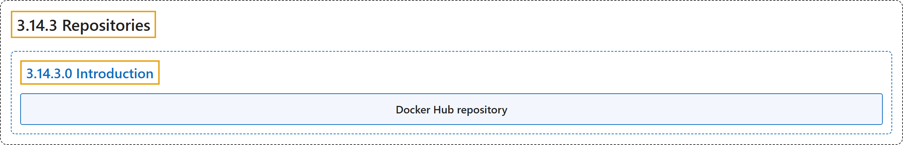

# 3.14.3 Repositories

## Classification

## Glossary

| Term | Definition | 中文翻译 | Source |
|---|---|---|---|
| **3.14.3 Repositories** 仓库 | (No definition) | （无定义） | [Docker Inc., n.d., "Repositories", documentation menu](https://docs.docker.com/docker-hub/repos/) |
| **3.14.3.0 Introduction** 简介 | (No definition) | （无定义） | [Docker Inc., n.d., "Repositories", opening](https://docs.docker.com/docker-hub/repos/) |
| **Docker Hub repository** Docker Hub 仓库 | "A Docker Hub repository is **a collection of container images, enabling you to store, manage, and share Docker images publicly or privately**." | Docker Hub 仓库是**一组容器镜像，让你可以公开或私有地存储、管理和共享 Docker 镜像**。 | [Docker Inc., n.d., "Repositories", para. 2](https://docs.docker.com/docker-hub/repos/#:~:text=A%20Docker%20Hub%20repository%20is%20a%20collection%20of) |

## References

Docker Inc. (n.d.). *Repositories*. Docker Docs. Retrieved November 2, 2026, from <https://docs.docker.com/docker-hub/repos/>
