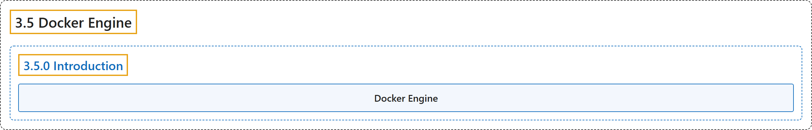

# 3.5 Docker Engine

## Classification

## Glossary

| Term | Definition | 中文翻译 | Source |
|---|---|---|---|
| **3.5 Docker Engine** Docker Engine | (No definition) | （无定义） | [Docker Inc., n.d., "Docker Engine", documentation menu](https://docs.docker.com/engine/) |
| **3.5.0 Introduction** 简介 | (No definition) | （无定义） | [Docker Inc., n.d., "Docker Engine", opening](https://docs.docker.com/engine/) |
| **Docker Engine** Docker 引擎 | "Docker Engine is **an open source containerization technology for building and containerizing your applications**." | Docker Engine 是**一种开源容器化技术，用于构建和容器化你的应用**。 | [Docker Inc., n.d., "Docker Engine", para. 1](https://docs.docker.com/engine/#:~:text=Docker%20Engine%20is%20an%20open%20source%20containerization%20technology) |

## References

Docker Inc. (n.d.). *Docker Engine*. Docker Docs. Retrieved November 2, 2026, from <https://docs.docker.com/engine/>
