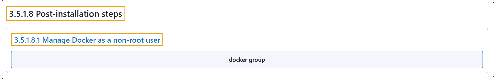

# 3.5.1.8 Post-installation steps

## Classification

## Glossary

| Term | Definition | 中文翻译 | Source |
|---|---|---|---|
| **3.5.1.8 Post-installation steps** Linux 安装后步骤 | (No definition) | （无定义） | [Docker Inc., n.d., "Post-installation steps", documentation menu](https://docs.docker.com/engine/install/linux-postinstall/) |
| **3.5.1.8.1 Manage Docker as a non-root user** Manage Docker as a non-root user | (No definition) | （无定义） | [Docker Inc., n.d., "Manage Docker as a non-root user", documentation menu](https://docs.docker.com/engine/install/linux-postinstall/) |
| **docker group** docker 用户组 | "When the Docker daemon starts, it **creates a Unix socket** accessible by **members of the `docker` group**." | Docker 守护进程启动时，会**创建一个 Unix 套接字**，供 **`docker` 组的成员**访问。 | [Docker Inc., n.d., "Manage Docker as a non-root user", para. 2](https://docs.docker.com/engine/install/linux-postinstall/#:~:text=When%20the%20Docker%20daemon%20starts%2C%20it%20creates%20a) |

## References

Docker Inc. (n.d.). *Post-installation steps*. Docker Docs. Retrieved November 2, 2026, from <https://docs.docker.com/engine/install/linux-postinstall/>
