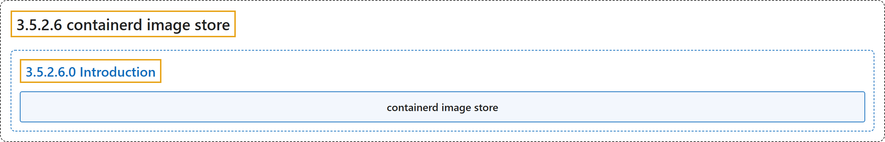

# 3.5.2.6 containerd image store

## Classification

## Glossary

| Term | Definition | 中文翻译 | Source |
|---|---|---|---|
| **3.5.2.6 containerd image store** containerd 镜像存储 | (No definition) | （无定义） | [Docker Inc., n.d., "containerd image store", documentation menu](https://docs.docker.com/engine/storage/containerd/) |
| **3.5.2.6.0 Introduction** 简介 | (No definition) | （无定义） | [Docker Inc., n.d., "containerd image store with Docker Engine", opening](https://docs.docker.com/engine/storage/containerd/) |
| **containerd image store** containerd 镜像存储 | "The containerd image store is **the default storage backend for Docker Engine 29.0 and later on fresh installations**." | containerd 镜像存储是**全新安装的 Docker Engine 29.0 及以后版本的默认存储后端**。 | [Docker Inc., n.d., "containerd image store with Docker Engine", para. 1](https://docs.docker.com/engine/storage/containerd/#:~:text=The%20containerd%20image%20store%20is%20the%20default%20storage) |

## References

Docker Inc. (n.d.). *containerd image store*. Docker Docs. Retrieved November 2, 2026, from <https://docs.docker.com/engine/storage/containerd/>
