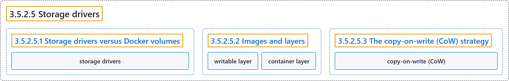

# 3.5.2.5 Storage drivers

## Classification

## Glossary

| Term | Definition | 中文翻译 | Source |
|---|---|---|---|
| **3.5.2.5 Storage drivers** 存储驱动 | (No definition) | （无定义） | [Docker Inc., n.d., "Storage drivers", documentation menu](https://docs.docker.com/engine/storage/drivers/) |
| **3.5.2.5.1 Storage drivers versus Docker volumes** Storage drivers versus Docker volumes | (No definition) | （无定义） | [Docker Inc., n.d., "Storage drivers versus Docker volumes", documentation menu](https://docs.docker.com/engine/storage/drivers/) |
| **storage drivers** 存储驱动 | "Docker uses storage drivers **to store image layers, and to store data in the writable layer of a container**." | Docker 用存储驱动**存储镜像层，以及容器可写层中的数据**。 | [Docker Inc., n.d., "Storage drivers versus Docker volumes", para. 1](https://docs.docker.com/engine/storage/drivers/#:~:text=Docker%20uses%20storage%20drivers%20to%20store%20image%20layers%2C) |
| **3.5.2.5.2 Images and layers** Images and layers | (No definition) | （无定义） | [Docker Inc., n.d., "Images and layers", documentation menu](https://docs.docker.com/engine/storage/drivers/) |
| **writable layer** 可写层 | "When you create a new container, you **add a new writable layer on top of the underlying layers**." | 创建新容器时，你会**在底层各层之上添加一个新的可写层**。 | [Docker Inc., n.d., "Images and layers", para. 4](https://docs.docker.com/engine/storage/drivers/#:~:text=When%20you%20create%20a%20new%20container%2C%20you%20add) |
| **container layer** 容器层 | "This layer is often called **the 'container layer'**." | 这一层通常称为 **“容器层”**。 | [Docker Inc., n.d., "Images and layers", para. 4](https://docs.docker.com/engine/storage/drivers/#:~:text=This%20layer%20is%20often%20called%20the%20%27container%20layer%27.) |
| **3.5.2.5.3 The copy-on-write (CoW) strategy** The copy-on-write (CoW) strategy | (No definition) | （无定义） | [Docker Inc., n.d., "The copy-on-write (CoW) strategy", documentation menu](https://docs.docker.com/engine/storage/drivers/) |
| **`copy-on-write (CoW)`** 写时复制 | "Copy-on-write is **a strategy of sharing and copying files for maximum efficiency**." | 写时复制是**一种共享和复制文件以获得最高效率的策略**。 | [Docker Inc., n.d., "The copy-on-write (CoW) strategy", para. 1](https://docs.docker.com/engine/storage/drivers/#:~:text=Copy-on-write%20is%20a%20strategy%20of%20sharing%20and%20copying) |

## References

Docker Inc. (n.d.). *Storage drivers*. Docker Docs. Retrieved November 2, 2026, from <https://docs.docker.com/engine/storage/drivers/>
