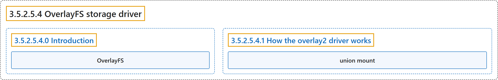

# 3.5.2.5.4 OverlayFS storage driver

## Classification

## Glossary

| Term | Definition | 中文翻译 | Source |
|---|---|---|---|
| **3.5.2.5.4 OverlayFS storage driver** OverlayFS 存储驱动 | (No definition) | （无定义） | [Docker Inc., n.d., "OverlayFS storage driver", documentation menu](https://docs.docker.com/engine/storage/drivers/overlayfs-driver/) |
| **3.5.2.5.4.0 Introduction** 简介 | (No definition) | （无定义） | [Docker Inc., n.d., "OverlayFS storage driver", opening](https://docs.docker.com/engine/storage/drivers/overlayfs-driver/) |
| **OverlayFS** OverlayFS | "**OverlayFS** is **a union filesystem**." | **OverlayFS** 是**一种联合文件系统**。 | [Docker Inc., n.d., "OverlayFS storage driver", para. 1](https://docs.docker.com/engine/storage/drivers/overlayfs-driver/#:~:text=OverlayFS%20is%20a%20union%20filesystem.) |
| **3.5.2.5.4.1 How the overlay2 driver works** How the overlay2 driver works | (No definition) | （无定义） | [Docker Inc., n.d., "How the overlay2 driver works", documentation menu](https://docs.docker.com/engine/storage/drivers/overlayfs-driver/) |
| **union mount** 联合挂载 | "**These directories** are called **layers**, and **the unification process** is referred to as **a union mount**." | **这些目录**称为**层**，而**统一它们的过程**称为**联合挂载**。 | [Docker Inc., n.d., "How the overlay2 driver works", para. 1](https://docs.docker.com/engine/storage/drivers/overlayfs-driver/#:~:text=These%20directories%20are%20called%20layers%2C%20and%20the%20unification) |

## References

Docker Inc. (n.d.). *OverlayFS storage driver*. Docker Docs. Retrieved November 2, 2026, from <https://docs.docker.com/engine/storage/drivers/overlayfs-driver/>
