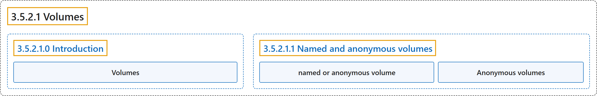

# 3.5.2.1 Volumes

## Classification

## Glossary

| Term | Definition | 中文翻译 | Source |
|---|---|---|---|
| **3.5.2.1 Volumes** 卷 | (No definition) | （无定义） | [Docker Inc., n.d., "Volumes", documentation menu](https://docs.docker.com/engine/storage/volumes/) |
| **3.5.2.1.0 Introduction** 简介 | (No definition) | （无定义） | [Docker Inc., n.d., "Volumes", opening](https://docs.docker.com/engine/storage/volumes/) |
| **Volumes** 卷 | "Volumes are **persistent data stores for containers, created and managed by Docker**." | 卷是**由 Docker 创建和管理的容器持久数据存储**。 | [Docker Inc., n.d., "Volumes", para. 1](https://docs.docker.com/engine/storage/volumes/#:~:text=Volumes%20are%20persistent%20data%20stores%20for%20containers%2C%20created) |
| **3.5.2.1.1 Named and anonymous volumes** Named and anonymous volumes | (No definition) | （无定义） | [Docker Inc., n.d., "Named and anonymous volumes", documentation menu](https://docs.docker.com/engine/storage/volumes/) |
| **named or anonymous volume** 命名卷或匿名卷 | "A volume may be **named or anonymous**." | 卷可以是**命名的或匿名的**。 | [Docker Inc., n.d., "Named and anonymous volumes", para. 1](https://docs.docker.com/engine/storage/volumes/#:~:text=A%20volume%20may%20be%20named%20or%20anonymous.) |
| **Anonymous volumes** 匿名卷 | "Anonymous volumes are **given a random name that's guaranteed to be unique within a given Docker host**." | 匿名卷**会被赋予一个在该 Docker 主机内保证唯一的随机名称**。 | [Docker Inc., n.d., "Named and anonymous volumes", para. 1](https://docs.docker.com/engine/storage/volumes/#:~:text=Anonymous%20volumes%20are%20given%20a%20random%20name%20that%27s) |

## References

Docker Inc. (n.d.). *Volumes*. Docker Docs. Retrieved November 2, 2026, from <https://docs.docker.com/engine/storage/volumes/>
