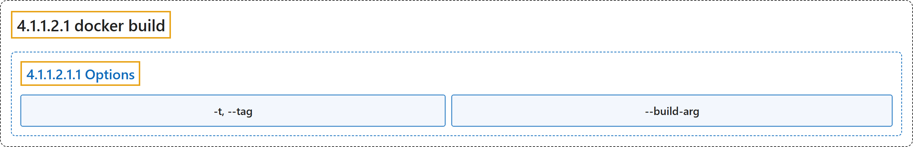

# 4.1.1.2.1 docker build

## Classification

## Glossary

| Term | Definition | 中文翻译 | Source |
|---|---|---|---|
| **4.1.1.2.1 docker build** 开始构建（别名 docker build、docker builder build、docker image build、docker buildx b） | "**Start a build**" | **开始一次构建** | [Docker Inc., n.d., "docker build", table](https://docs.docker.com/reference/cli/docker/buildx/build/#:~:text=Start%20a%20build) |
| **4.1.1.2.1.1 Options** 选项 | (No definition) | （无定义） | [Docker Inc., n.d., "Options", table](https://docs.docker.com/reference/cli/docker/buildx/build/) |
| **`-t, --tag`** 标签 | "**Image identifier** (format: **[registry/]repository[:tag]** )" | **镜像标识**（格式：**[registry/]repository[:tag]**） | [Docker Inc., n.d., "Options", table](https://docs.docker.com/reference/cli/docker/buildx/build/#:~:text=Image%20identifier%20%28format%3A%20%5Bregistry%2F%5Drepository%5B%3Atag%5D%20%29) |
| **`--build-arg`** 构建参数 | "**Set build-time variables**" | **设置构建时变量** | [Docker Inc., n.d., "Options", table](https://docs.docker.com/reference/cli/docker/buildx/build/#:~:text=Set%20build-time%20variables) |

## References

Docker Inc. (n.d.). *docker build*. Docker Docs. Retrieved November 2, 2026, from <https://docs.docker.com/reference/cli/docker/buildx/build/>
