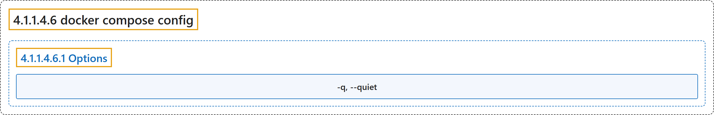

# 4.1.1.4.6 docker compose config

## Classification

## Glossary

| Term | Definition | 中文翻译 | Source |
|---|---|---|---|
| **4.1.1.4.6 docker compose config** 检查 Compose 配置 | "**Parse, resolve and render** compose file in **canonical format**" | **解析、求值并渲染** Compose 文件，输出为**规范格式** | [Docker Inc., n.d., "docker compose config", table](https://docs.docker.com/reference/cli/docker/compose/config/#:~:text=Parse%2C%20resolve%20and%20render%20compose%20file%20in%20canonical) |
| **4.1.1.4.6.1 Options** 选项 | (No definition) | （无定义） | [Docker Inc., n.d., "Options", table](https://docs.docker.com/reference/cli/docker/compose/config/) |
| **`-q, --quiet`** 静默 | "**Only validate** the configuration, **don't print anything**" | **只验证**配置，**不打印任何内容** | [Docker Inc., n.d., "Options", table](https://docs.docker.com/reference/cli/docker/compose/config/#:~:text=Only%20validate%20the%20configuration%2C%20don%27t%20print%20anything) |

## References

Docker Inc. (n.d.). *docker compose config*. Docker Docs. Retrieved November 2, 2026, from <https://docs.docker.com/reference/cli/docker/compose/config/>
