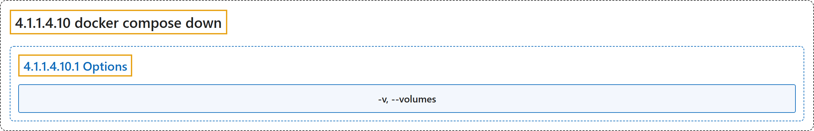

# 4.1.1.4.10 docker compose down

## Classification

## Glossary

| Term | Definition | 中文翻译 | Source |
|---|---|---|---|
| **4.1.1.4.10 docker compose down** 停止并删除 Compose 应用 | "**Stop and remove containers, networks**" | **停止并删除容器、网络** | [Docker Inc., n.d., "docker compose down", table](https://docs.docker.com/reference/cli/docker/compose/down/#:~:text=Stop%20and%20remove%20containers%2C%20networks) |
| **4.1.1.4.10.1 Options** 选项 | (No definition) | （无定义） | [Docker Inc., n.d., "Options", table](https://docs.docker.com/reference/cli/docker/compose/down/) |
| **`-v, --volumes`** 卷 | "**Remove named volumes** declared in the "volumes" section of the Compose file and **anonymous volumes attached to containers**" | **删除命名卷**（即 Compose 文件 volumes 部分声明的卷），以及**附加到容器的匿名卷** | [Docker Inc., n.d., "Options", table](https://docs.docker.com/reference/cli/docker/compose/down/#:~:text=Remove%20named%20volumes%20declared%20in%20the%20%22volumes%22%20section) |

## References

Docker Inc. (n.d.). *docker compose down*. Docker Docs. Retrieved November 2, 2026, from <https://docs.docker.com/reference/cli/docker/compose/down/>
