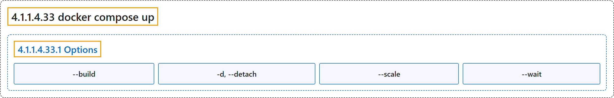

# 4.1.1.4.33 docker compose up

## Classification

## Glossary

| Term | Definition | 中文翻译 | Source |
|---|---|---|---|
| **4.1.1.4.33 docker compose up** 启动 Compose 应用 | "**Create and start containers**" | **创建并启动容器** | [Docker Inc., n.d., "docker compose up", table](https://docs.docker.com/reference/cli/docker/compose/up/#:~:text=Create%20and%20start%20containers) |
| **4.1.1.4.33.1 Options** 选项 | (No definition) | （无定义） | [Docker Inc., n.d., "Options", table](https://docs.docker.com/reference/cli/docker/compose/up/) |
| **`--build`** 先构建 | "**Build images** before **starting containers**" | **构建镜像**，之后才**启动容器** | [Docker Inc., n.d., "Options", table](https://docs.docker.com/reference/cli/docker/compose/up/#:~:text=Build%20images%20before%20starting%20containers) |
| **`-d, --detach`** 后台运行 | "**Detached mode**: Run containers in **the background**" | **分离模式**：在**后台**运行容器 | [Docker Inc., n.d., "Options", table](https://docs.docker.com/reference/cli/docker/compose/up/#:~:text=Detached%20mode%3A%20Run%20containers%20in%20the%20background) |
| **`--scale`** 扩展实例 | "**Scale SERVICE to NUM instances**. Overrides **the scale setting in the Compose file** if present." | **把 SERVICE 扩展到 NUM 个实例**。若有，则覆盖 **Compose 文件里的 scale 设置**。 | [Docker Inc., n.d., "Options", table](https://docs.docker.com/reference/cli/docker/compose/up/#:~:text=Scale%20SERVICE%20to%20NUM%20instances.%20Overrides%20the%20scale) |
| **`--wait`** 等待 | "**Wait for services** to be running\|healthy. **Implies detached mode**." | **等待服务**进入 running 或 healthy 状态。**隐含分离模式**。 | [Docker Inc., n.d., "Options", table](https://docs.docker.com/reference/cli/docker/compose/up/#:~:text=Wait%20for%20services%20to%20be%20running%7Chealthy.%20Implies%20detached) |

## References

Docker Inc. (n.d.). *docker compose up*. Docker Docs. Retrieved November 2, 2026, from <https://docs.docker.com/reference/cli/docker/compose/up/>
