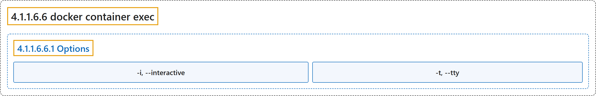

# 4.1.1.6.6 docker container exec

## Classification

## Glossary

| Term | Definition | 中文翻译 | Source |
|---|---|---|---|
| **4.1.1.6.6 docker container exec** 在容器中执行命令（别名 docker exec） | "**Execute a command in a running container**" | **在正在运行的容器中执行命令** | [Docker Inc., n.d., "docker container exec", table](https://docs.docker.com/reference/cli/docker/container/exec/#:~:text=Execute%20a%20command%20in%20a%20running%20container) |
| **4.1.1.6.6.1 Options** 选项 | (No definition) | （无定义） | [Docker Inc., n.d., "Options", table](https://docs.docker.com/reference/cli/docker/container/exec/) |
| **`-i, --interactive`** 交互 | "**Keep STDIN open even if not attached**" | **即使没有连接也保持 STDIN 打开** | [Docker Inc., n.d., "Options", table](https://docs.docker.com/reference/cli/docker/container/exec/#:~:text=Keep%20STDIN%20open%20even%20if%20not%20attached) |
| **`-t, --tty`** 伪终端 | "**Allocate a pseudo-TTY**" | **分配一个伪终端** | [Docker Inc., n.d., "Options", table](https://docs.docker.com/reference/cli/docker/container/exec/#:~:text=Allocate%20a%20pseudo-TTY) |

## References

Docker Inc. (n.d.). *docker container exec*. Docker Docs. Retrieved November 2, 2026, from <https://docs.docker.com/reference/cli/docker/container/exec/>
