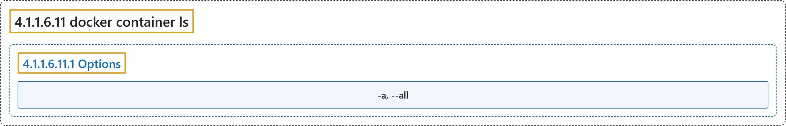

# 4.1.1.6.11 docker container ls

## Classification

## Glossary

| Term | Definition | 中文翻译 | Source |
|---|---|---|---|
| **4.1.1.6.11 docker container ls** 列出容器（别名 docker container list、docker container ps、docker ps） | "**List containers**" | **列出容器** | [Docker Inc., n.d., "docker container ls", table](https://docs.docker.com/reference/cli/docker/container/ls/#:~:text=List%20containers) |
| **4.1.1.6.11.1 Options** 选项 | (No definition) | （无定义） | [Docker Inc., n.d., "Options", table](https://docs.docker.com/reference/cli/docker/container/ls/) |
| **`-a, --all`** 全部 | "**Show all containers (default shows just running)**" | **显示所有容器（默认只显示正在运行的）** | [Docker Inc., n.d., "Options", table](https://docs.docker.com/reference/cli/docker/container/ls/#:~:text=Show%20all%20containers%20%28default%20shows%20just%20running%29) |

## References

Docker Inc. (n.d.). *docker container ls*. Docker Docs. Retrieved November 2, 2026, from <https://docs.docker.com/reference/cli/docker/container/ls/>
