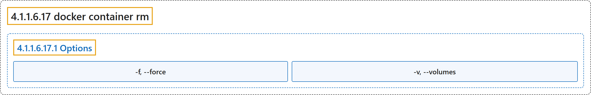

# 4.1.1.6.17 docker container rm

## Classification

## Glossary

| Term | Definition | 中文翻译 | Source |
|---|---|---|---|
| **4.1.1.6.17 docker container rm** 删除容器（别名 docker container remove、docker rm） | "**Remove** one or more **containers**" | **删除**一个或多个**容器** | [Docker Inc., n.d., "docker container rm", table](https://docs.docker.com/reference/cli/docker/container/rm/#:~:text=Remove%20one%20or%20more%20containers) |
| **4.1.1.6.17.1 Options** 选项 | (No definition) | （无定义） | [Docker Inc., n.d., "Options", table](https://docs.docker.com/reference/cli/docker/container/rm/) |
| **`-f, --force`** 强制 | "**Force the removal** of **a running container** (uses **SIGKILL**)" | **强制删除**一个**正在运行的容器**（使用 **SIGKILL**） | [Docker Inc., n.d., "Options", table](https://docs.docker.com/reference/cli/docker/container/rm/#:~:text=Force%20the%20removal%20of%20a%20running%20container%20%28uses) |
| **`-v, --volumes`** 卷 | "**Remove anonymous volumes** associated with **the container**" | **删除匿名卷**，这些卷与**该容器**关联 | [Docker Inc., n.d., "Options", table](https://docs.docker.com/reference/cli/docker/container/rm/#:~:text=Remove%20anonymous%20volumes%20associated%20with%20the%20container) |

## References

Docker Inc. (n.d.). *docker container rm*. Docker Docs. Retrieved November 2, 2026, from <https://docs.docker.com/reference/cli/docker/container/rm/>
