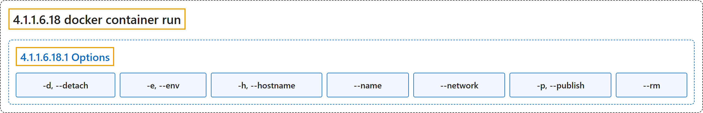

# 4.1.1.6.18 docker container run

## Classification

## Glossary

| Term | Definition | 中文翻译 | Source |
|---|---|---|---|
| **4.1.1.6.18 docker container run** 运行容器（别名 docker run） | "**Create and run a new container** from **an image**" | **创建并运行一个新容器**，基于**某个镜像** | [Docker Inc., n.d., "docker container run", table](https://docs.docker.com/reference/cli/docker/container/run/#:~:text=Create%20and%20run%20a%20new%20container%20from%20an) |
| **4.1.1.6.18.1 Options** 选项 | (No definition) | （无定义） | [Docker Inc., n.d., "Options", table](https://docs.docker.com/reference/cli/docker/container/run/) |
| **`-d, --detach`** 后台运行 | "**Run container in background** and **print container ID**" | **在后台运行容器**并**打印容器 ID** | [Docker Inc., n.d., "Options", table](https://docs.docker.com/reference/cli/docker/container/run/#:~:text=Run%20container%20in%20background%20and%20print%20container%20ID) |
| **`-e, --env`** 环境变量 | "**Set environment variables**" | **设置环境变量** | [Docker Inc., n.d., "Options", table](https://docs.docker.com/reference/cli/docker/container/run/#:~:text=Set%20environment%20variables) |
| **`-h, --hostname`** 主机名 | "**Container host name**" | **容器主机名** | [Docker Inc., n.d., "Options", table](https://docs.docker.com/reference/cli/docker/container/run/#:~:text=Container%20host%20name) |
| **`--name`** 名称 | "**Assign a name** to **the container**" | **指定名称**给**容器** | [Docker Inc., n.d., "Options", table](https://docs.docker.com/reference/cli/docker/container/run/#:~:text=Assign%20a%20name%20to%20the%20container) |
| **`--network`** 网络 | "**Connect a container** to **a network**" | **把容器连接**到**一个网络** | [Docker Inc., n.d., "Options", table](https://docs.docker.com/reference/cli/docker/container/run/#:~:text=Connect%20a%20container%20to%20a%20network) |
| **`-p, --publish`** 发布端口 | "**Publish a container's port(s)** to **the host**" | **发布容器的端口**到**主机** | [Docker Inc., n.d., "Options", table](https://docs.docker.com/reference/cli/docker/container/run/#:~:text=Publish%20a%20container%27s%20port%28s%29%20to%20the%20host) |
| **`--rm`** 退出后删除 | "**Automatically remove the container** and **its associated anonymous volumes** when it **exits**" | **自动删除容器**和**其关联的匿名卷**，时机是容器**退出**时 | [Docker Inc., n.d., "Options", table](https://docs.docker.com/reference/cli/docker/container/run/#:~:text=Automatically%20remove%20the%20container%20and%20its%20associated%20anonymous) |

## References

Docker Inc. (n.d.). *docker container run*. Docker Docs. Retrieved November 2, 2026, from <https://docs.docker.com/reference/cli/docker/container/run/>
