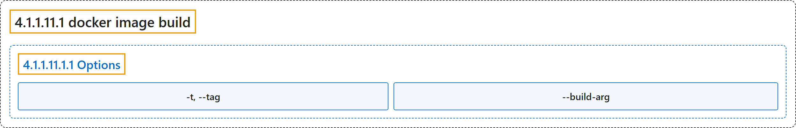

# 4.1.1.11.1 docker image build

## Classification

## Glossary

| Term | Definition | 中文翻译 | Source |
|---|---|---|---|
| **4.1.1.11.1 docker image build** 构建镜像（别名 docker build、docker builder build） | "**Build an image from a Dockerfile**" | **从 Dockerfile 构建镜像** | [Docker Inc., n.d., "docker image build", table](https://docs.docker.com/reference/cli/docker/image/build/#:~:text=Build%20an%20image%20from%20a%20Dockerfile) |
| **4.1.1.11.1.1 Options** 选项 | (No definition) | （无定义） | [Docker Inc., n.d., "Options", table](https://docs.docker.com/reference/cli/docker/image/build/) |
| **`-t, --tag`** 标签 | "**Name and optionally a tag in the name:tag format**" | **名称，以及可选的 name:tag 格式标签** | [Docker Inc., n.d., "Options", table](https://docs.docker.com/reference/cli/docker/image/build/#:~:text=Name%20and%20optionally%20a%20tag%20in%20the%20name%3Atag) |
| **`--build-arg`** 构建参数 | "**Set build-time variables**" | **设置构建时变量** | [Docker Inc., n.d., "Options", table](https://docs.docker.com/reference/cli/docker/image/build/#:~:text=Set%20build-time%20variables) |

## References

Docker Inc. (n.d.). *docker image build*. Docker Docs. Retrieved November 2, 2026, from <https://docs.docker.com/reference/cli/docker/image/build/>
