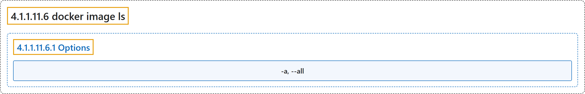

# 4.1.1.11.6 docker image ls

## Classification

## Glossary

| Term | Definition | 中文翻译 | Source |
|---|---|---|---|
| **4.1.1.11.6 docker image ls** 列出镜像（别名 docker image list、docker images） | "**List images**" | **列出镜像** | [Docker Inc., n.d., "docker image ls", table](https://docs.docker.com/reference/cli/docker/image/ls/#:~:text=List%20images) |
| **4.1.1.11.6.1 Options** 选项 | (No definition) | （无定义） | [Docker Inc., n.d., "Options", table](https://docs.docker.com/reference/cli/docker/image/ls/) |
| **`-a, --all`** 全部 | "**Show all images (default hides intermediate and dangling images)**" | **显示所有镜像（默认隐藏中间镜像和悬空镜像）** | [Docker Inc., n.d., "Options", table](https://docs.docker.com/reference/cli/docker/image/ls/#:~:text=Show%20all%20images%20%28default%20hides%20intermediate%20and%20dangling) |

## References

Docker Inc. (n.d.). *docker image ls*. Docker Docs. Retrieved November 2, 2026, from <https://docs.docker.com/reference/cli/docker/image/ls/>
