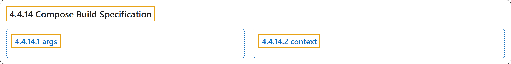

# 4.4.14 Compose Build Specification

## Classification

## Glossary

| Term | Definition | 中文翻译 | Source |
|---|---|---|---|
| **4.4.14 Compose Build Specification** Compose 构建规范 | (No definition) | （无定义） | [Docker Inc., n.d., "Compose Build Specification", documentation menu](https://docs.docker.com/reference/compose-file/build/) |
| **4.4.14.1 args** args 键 | "**`args`** define **build arguments**, that is **Dockerfile `ARG` values**." | **`args`** 定义**构建参数**，也就是 **Dockerfile 的 `ARG` 值**。 | [Docker Inc., n.d., "args", para. 1](https://docs.docker.com/reference/compose-file/build/#:~:text=%60args%60%20define%20build%20arguments%2C%20that%20is%20Dockerfile%20%60ARG%60) |
| **4.4.14.2 context** context 键 | "**`context`** defines either **a path to a directory containing a Dockerfile**, or **a URL to a Git repository**." | **`context`** 定义**包含 Dockerfile 的目录路径**，或者 **Git 仓库的 URL**。 | [Docker Inc., n.d., "context", para. 1](https://docs.docker.com/reference/compose-file/build/#:~:text=%60context%60%20defines%20either%20a%20path%20to%20a%20directory) |

## References

Docker Inc. (n.d.). *Compose Build Specification*. Docker Docs. Retrieved November 2, 2026, from <https://docs.docker.com/reference/compose-file/build/>
