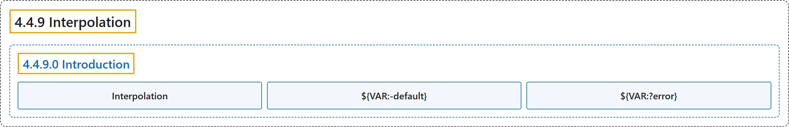

# 4.4.9 Interpolation

## Classification

## Glossary

| Term | Definition | 中文翻译 | Source |
|---|---|---|---|
| **4.4.9 Interpolation** 变量插值 | (No definition) | （无定义） | [Docker Inc., n.d., "Interpolation", documentation menu](https://docs.docker.com/reference/compose-file/interpolation/) |
| **4.4.9.0 Introduction** 简介 | (No definition) | （无定义） | [Docker Inc., n.d., "Interpolation", opening](https://docs.docker.com/reference/compose-file/interpolation/) |
| **Interpolation** 变量插值 | "Values in a Compose file can be **set by variables and interpolated at runtime**." | Compose 文件中的值可以**由变量设置，并在运行时插值**。 | [Docker Inc., n.d., "Interpolation", para. 1](https://docs.docker.com/reference/compose-file/interpolation/#:~:text=Values%20in%20a%20Compose%20file%20can%20be%20set) |
| **`${VAR:-default}`** 默认值 | "`${VAR:-default}` -> **value of `VAR` if set and non-empty, otherwise `default`**" | `${VAR:-default}` -> **`VAR` 已设置且非空时取其值，否则取 `default`** | [Docker Inc., n.d., "Interpolation", para. 4](https://docs.docker.com/reference/compose-file/interpolation/#:~:text=%60%24%7BVAR%3A-default%7D%60%20-%3E%20value%20of%20%60VAR%60%20if%20set%20and) |
| **`${VAR:?error}`** 必填值 | "`${VAR:?error}` -> **value of `VAR` if set and non-empty, otherwise exit with error**" | `${VAR:?error}` -> **`VAR` 已设置且非空时取其值，否则报错退出** | [Docker Inc., n.d., "Interpolation", para. 5](https://docs.docker.com/reference/compose-file/interpolation/#:~:text=%60%24%7BVAR%3A%3Ferror%7D%60%20-%3E%20value%20of%20%60VAR%60%20if%20set%20and) |

## References

Docker Inc. (n.d.). *Interpolation*. Docker Docs. Retrieved November 2, 2026, from <https://docs.docker.com/reference/compose-file/interpolation/>
