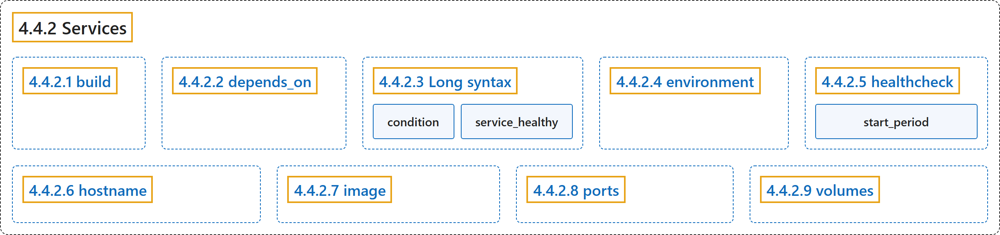

# 4.4.2 Services

## Classification

## Glossary

| Term | Definition | 中文翻译 | Source |
|---|---|---|---|
| **4.4.2 Services** 服务 | (No definition) | （无定义） | [Docker Inc., n.d., "Services", documentation menu](https://docs.docker.com/reference/compose-file/services/) |
| **4.4.2.1 build** build 键 | "`build` **specifies the build configuration for creating a container image from source**, as defined in the Compose Build Specification." | `build` **指定从源码创建容器镜像的构建配置**，其定义见 Compose Build Specification。 | [Docker Inc., n.d., "build", para. 1](https://docs.docker.com/reference/compose-file/services/#:~:text=%60build%60%20specifies%20the%20build%20configuration%20for%20creating%20a) |
| **4.4.2.2 depends_on** depends_on 键 | "With the `depends_on` attribute, you can **control the order of service startup and shutdown**." | 使用 `depends_on` 属性，你可以**控制服务启动和关闭的顺序**。 | [Docker Inc., n.d., "depends_on", para. 1](https://docs.docker.com/reference/compose-file/services/#:~:text=With%20the%20%60depends_on%60%20attribute%2C%20you%20can%20control%20the) |
| **4.4.2.3 Long syntax** Long syntax | (No definition) | （无定义） | [Docker Inc., n.d., "Long syntax", documentation menu](https://docs.docker.com/reference/compose-file/services/) |
| **condition** condition 键 | "`condition`: **Sets the condition under which dependency is considered satisfied**" | `condition`：**设置依赖被视为满足的条件** | [Docker Inc., n.d., "Long syntax", para. 3](https://docs.docker.com/reference/compose-file/services/#:~:text=%60condition%60%3A%20Sets%20the%20condition%20under%20which%20dependency%20is) |
| **`service_healthy`** 依赖健康 | "`service_healthy`: **Specifies that a dependency is expected to be 'healthy'** (as indicated by healthcheck) before starting a dependent service." | `service_healthy`：**指定依赖应处于 healthy 状态**（由 healthcheck 判断），之后才启动依赖它的服务。 | [Docker Inc., n.d., "Long syntax", para. 3](https://docs.docker.com/reference/compose-file/services/#:~:text=%60service_healthy%60%3A%20Specifies%20that%20a%20dependency%20is%20expected%20to) |
| **4.4.2.4 environment** environment 键 | "The `environment` attribute **defines environment variables set in the container**." | `environment` 属性**定义在容器中设置的环境变量**。 | [Docker Inc., n.d., "environment", para. 1](https://docs.docker.com/reference/compose-file/services/#:~:text=The%20%60environment%60%20attribute%20defines%20environment%20variables%20set%20in) |
| **4.4.2.5 healthcheck** healthcheck 键 | "The `healthcheck` attribute **declares a check that's run to determine whether or not the service containers are 'healthy'**." | `healthcheck` 属性**声明一项检查，用来判断服务容器是否处于 healthy 状态**。 | [Docker Inc., n.d., "healthcheck", para. 1](https://docs.docker.com/reference/compose-file/services/#:~:text=The%20%60healthcheck%60%20attribute%20declares%20a%20check%20that%27s%20run) |
| **`start_period`** 启动宽限期 | "`interval`, `timeout`, **`start_period`**, and `start_interval` are specified as durations." | `interval`、`timeout`、**`start_period`** 和 `start_interval` 都用时长表示。 | [Docker Inc., n.d., "healthcheck", para. 3](https://docs.docker.com/reference/compose-file/services/#:~:text=%60interval%60%2C%20%60timeout%60%2C%20%60start_period%60%2C%20and%20%60start_interval%60%20are%20specified%20as) |
| **4.4.2.6 hostname** hostname 键 | "`hostname` **declares a custom host name to use for the service container**." | `hostname` **声明服务容器使用的自定义主机名**。 | [Docker Inc., n.d., "hostname", para. 1](https://docs.docker.com/reference/compose-file/services/#:~:text=%60hostname%60%20declares%20a%20custom%20host%20name%20to%20use) |
| **4.4.2.7 image** image 键 | "`image` **specifies the image to start the container from**." | `image` **指定启动容器所用的镜像**。 | [Docker Inc., n.d., "image", para. 1](https://docs.docker.com/reference/compose-file/services/#:~:text=%60image%60%20specifies%20the%20image%20to%20start%20the%20container) |
| **4.4.2.8 ports** ports 键 | "The `ports` is used to **define the port mappings between the host machine and the containers**." | `ports` 用来**定义主机和容器之间的端口映射**。 | [Docker Inc., n.d., "ports", para. 1](https://docs.docker.com/reference/compose-file/services/#:~:text=The%20%60ports%60%20is%20used%20to%20define%20the%20port) |
| **4.4.2.9 volumes** volumes 键 | "The `volumes` attribute **define mount host paths or named volumes that are accessible by service containers**." | `volumes` 属性**定义服务容器可访问的挂载主机路径或命名卷**。 | [Docker Inc., n.d., "volumes", para. 1](https://docs.docker.com/reference/compose-file/services/#:~:text=The%20%60volumes%60%20attribute%20define%20mount%20host%20paths%20or) |

## References

Docker Inc. (n.d.). *Services*. Docker Docs. Retrieved November 2, 2026, from <https://docs.docker.com/reference/compose-file/services/>
