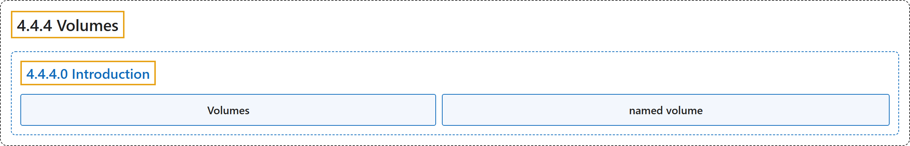

# 4.4.4 Volumes

## Classification

## Glossary

| Term | Definition | 中文翻译 | Source |
|---|---|---|---|
| **4.4.4 Volumes** 卷 | (No definition) | （无定义） | [Docker Inc., n.d., "Volumes", documentation menu](https://docs.docker.com/reference/compose-file/volumes/) |
| **4.4.4.0 Introduction** 简介 | (No definition) | （无定义） | [Docker Inc., n.d., "Define and manage volumes in Docker Compose", opening](https://docs.docker.com/reference/compose-file/volumes/) |
| **Volumes** 卷 | "**Volumes** are **persistent data stores** implemented by **the container engine**." | **卷**是**持久数据存储**，由**容器引擎**实现。 | [Docker Inc., n.d., "Define and manage volumes in Docker Compose", para. 1](https://docs.docker.com/reference/compose-file/volumes/#:~:text=Volumes%20are%20persistent%20data%20stores%20implemented%20by%20the) |
| **named volume** 命名卷 | "The **top-level `volumes` declaration** lets you **configure named volumes** that can be **reused across multiple services**." | **顶层 `volumes` 声明**让你**配置命名卷**，这些卷可以**在多个服务间复用**。 | [Docker Inc., n.d., "Define and manage volumes in Docker Compose", para. 1](https://docs.docker.com/reference/compose-file/volumes/#:~:text=The%20top-level%20%60volumes%60%20declaration%20lets%20you%20configure%20named) |

## References

Docker Inc. (n.d.). *Volumes*. Docker Docs. Retrieved November 2, 2026, from <https://docs.docker.com/reference/compose-file/volumes/>
