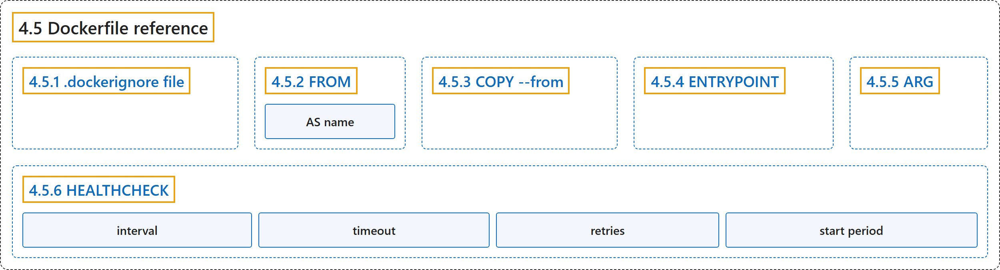

# 4.5 Dockerfile reference

## Classification

## Glossary

| Term | Definition | 中文翻译 | Source |
|---|---|---|---|
| **4.5 Dockerfile reference** Dockerfile | (No definition) | （无定义） | [Docker Inc., n.d., "Dockerfile reference", documentation menu](https://docs.docker.com/reference/dockerfile/) |
| **4.5.1 .dockerignore file** .dockerignore 文件 | "You can use **`.dockerignore` file** to **exclude files and directories** from **the build context**." | 你可以用 **`.dockerignore` 文件**来**排除文件和目录**，使其不进入**构建上下文**。 | [Docker Inc., n.d., ".dockerignore file", para. 1](https://docs.docker.com/reference/dockerfile/#:~:text=You%20can%20use%20%60.dockerignore%60%20file%20to%20exclude%20files) |
| **4.5.2 FROM** FROM 指令 | "The **`FROM` instruction** initializes **a new build stage** and **sets the base image** for subsequent instructions." | **`FROM` 指令**初始化**一个新的构建阶段**，并**设置基础镜像**，供后续指令使用。 | [Docker Inc., n.d., "FROM", para. 3](https://docs.docker.com/reference/dockerfile/#:~:text=The%20%60FROM%60%20instruction%20initializes%20a%20new%20build%20stage) |
| **AS name** 命名构建阶段 | "Optionally a name can be given to **a new build stage** by **adding `AS name` to the `FROM` instruction**." | 可以选择为**新的构建阶段**命名，方法是**在 `FROM` 指令后加上 `AS name`**。 | [Docker Inc., n.d., "FROM", para. 6](https://docs.docker.com/reference/dockerfile/#:~:text=Optionally%20a%20name%20can%20be%20given%20to%20a) |
| **4.5.3 COPY --from** 从其他来源复制 | "The **`COPY --from` flag** lets you **copy files** from **an image, a build stage, or a named context** instead." | **`COPY --from` 标志**让你改为**复制文件**，来源是**镜像、构建阶段或命名上下文**。 | [Docker Inc., n.d., "COPY --from", para. 1](https://docs.docker.com/reference/dockerfile/#:~:text=The%20%60COPY%20--from%60%20flag%20lets%20you%20copy%20files) |
| **4.5.4 ENTRYPOINT** ENTRYPOINT 指令 | "An **`ENTRYPOINT`** allows you to **configure a container** that will **run as an executable**." | **`ENTRYPOINT`** 让你**配置一个容器**，使其**像可执行程序一样运行**。 | [Docker Inc., n.d., "ENTRYPOINT", para. 1](https://docs.docker.com/reference/dockerfile/#:~:text=An%20%60ENTRYPOINT%60%20allows%20you%20to%20configure%20a%20container) |
| **4.5.5 ARG** ARG 指令 | "The **`ARG` instruction** defines **a variable** that users can **pass at build time to the builder** with the `docker build` command using the **`--build-arg <varname>=<value>` flag**." | **`ARG` 指令**定义**一个变量**，用户可以**在构建时把它传给构建器**，方法是在 `docker build` 命令中使用 **`--build-arg <varname>=<value>` 标志**。 | [Docker Inc., n.d., "ARG", para. 1](https://docs.docker.com/reference/dockerfile/#:~:text=The%20%60ARG%60%20instruction%20defines%20a%20variable%20that%20users) |
| **4.5.6 HEALTHCHECK** HEALTHCHECK 指令 | "`HEALTHCHECK [OPTIONS] CMD command` (**check container health** by **running a command inside the container**)" | `HEALTHCHECK [OPTIONS] CMD command`（**检查容器健康状况**，方法是**在容器内运行命令**） | [Docker Inc., n.d., "HEALTHCHECK", para. 2](https://docs.docker.com/reference/dockerfile/#:~:text=%60HEALTHCHECK%20%5BOPTIONS%5D%20CMD%20command%60%20%28check%20container%20health%20by) |
| **interval** 检查间隔 | "The health check will first run **interval** seconds after the container is started, and then again **interval** seconds after each previous check completes." | 健康检查在容器启动 **interval** 秒后首次运行，之后在每次检查完成 **interval** 秒后再次运行。 | [Docker Inc., n.d., "HEALTHCHECK", para. 12](https://docs.docker.com/reference/dockerfile/#:~:text=The%20health%20check%20will%20first%20run%20interval%20seconds) |
| **timeout** 单次超时 | "If a single run of the check **takes longer than timeout seconds** then the check is **considered to have failed**." | 如果单次检查**耗时超过 timeout 秒**，这次检查就**算失败**。 | [Docker Inc., n.d., "HEALTHCHECK", para. 13](https://docs.docker.com/reference/dockerfile/#:~:text=If%20a%20single%20run%20of%20the%20check%20takes) |
| **retries** 重试次数 | "It takes **retries consecutive failures** of the health check for the container to be **considered `unhealthy`**." | 健康检查**连续失败 retries 次**后，容器才**被视为 `unhealthy`**。 | [Docker Inc., n.d., "HEALTHCHECK", para. 14](https://docs.docker.com/reference/dockerfile/#:~:text=It%20takes%20retries%20consecutive%20failures%20of%20the%20health) |
| **start period** 启动宽限期 | "**start period** provides **initialization time** for containers that **need time to bootstrap**." | **start period** 提供**初始化时间**，给**需要时间启动**的容器。 | [Docker Inc., n.d., "HEALTHCHECK", para. 15](https://docs.docker.com/reference/dockerfile/#:~:text=start%20period%20provides%20initialization%20time%20for%20containers%20that) |

## References

Docker Inc. (n.d.). *Dockerfile reference*. Docker Docs. Retrieved November 2, 2026, from <https://docs.docker.com/reference/dockerfile/>
