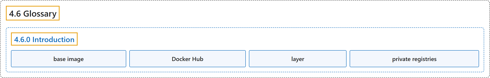

# 4.6 Glossary

## Classification

## Glossary

| Term | Definition | 中文翻译 | Source |
|---|---|---|---|
| **4.6 Glossary** 术语表 | (No definition) | （无定义） | [Docker Inc., n.d., "Glossary", documentation menu](https://docs.docker.com/reference/glossary/) |
| **4.6.0 Introduction** 简介 | (No definition) | （无定义） | [Docker Inc., n.d., "Glossary", opening](https://docs.docker.com/reference/glossary/) |
| **base image** 基础镜像 | "**A base image** is an image you **designate in a FROM directive** in **a Dockerfile**." | **基础镜像**是你**在 FROM 指令中指定**的镜像，位于 **Dockerfile** 中。 | [Docker Inc., n.d., "Glossary", table](https://docs.docker.com/reference/glossary/#:~:text=A%20base%20image%20is%20an%20image%20you%20designate) |
| **Docker Hub** Docker Hub | "**Docker Hub** is **Docker’s public registry service** where users can **store, share, and manage container images**." | **Docker Hub** 是 **Docker 的公共注册表服务**，用户可以在其中**存储、共享和管理容器镜像**。 | [Docker Inc., n.d., "Glossary", table](https://docs.docker.com/reference/glossary/#:~:text=Docker%20Hub%20is%20Docker%27s%20public%20registry%20service%20where) |
| **layer** 层 | "In an image, **a layer** is **a modification** represented by **an instruction in the Dockerfile**." | 在镜像中，**层**是**一次修改**，由 **Dockerfile 中的一条指令**表示。 | [Docker Inc., n.d., "Glossary", table](https://docs.docker.com/reference/glossary/#:~:text=In%20an%20image%2C%20a%20layer%20is%20a%20modification) |
| **private registries** 私有注册表 | "**The default public registry** is **Docker Hub**, but you can also **set up private registries** using **Docker Distribution**." | **默认的公共注册表**是 **Docker Hub**，但你也可以**搭建私有注册表**，用的是 **Docker Distribution**。 | [Docker Inc., n.d., "Glossary", table](https://docs.docker.com/reference/glossary/#:~:text=The%20default%20public%20registry%20is%20Docker%20Hub%2C%20but) |

## References

Docker Inc. (n.d.). *Glossary*. Docker Docs. Retrieved November 2, 2026, from <https://docs.docker.com/reference/glossary/>
