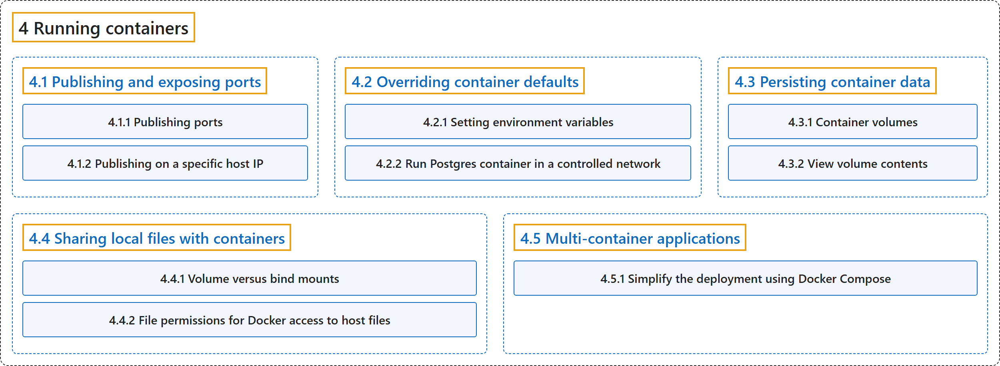

# 4 Running containers

## Classification

## Glossary

| Term | Definition | 中文翻译 | Source |
|---|---|---|---|
| **4 Running containers** 运行容器 | (No definition) | （无定义） | [Docker Inc., n.d.-a, "Running containers", documentation menu](https://docs.docker.com/get-started/) |
| **[4.1 Publishing and exposing ports](publishing-ports.md)** 发布和暴露端口 | (context) "Publishing a port provides **the ability to break through a little bit of networking isolation by setting up a forwarding rule**." | （语境）发布端口提供了**通过设置转发规则来突破一部分网络隔离的能力**。 | [Docker Inc., n.d.-e, "Publishing ports", para. 1](https://docs.docker.com/get-started/docker-concepts/running-containers/publishing-ports/#:~:text=Publishing%20a%20port%20provides%20the%20ability%20to) |
| **[4.2 Overriding container defaults](overriding-container-defaults.md)** 覆盖容器默认设置 | (context) "Containers come with **default settings that usually work well, but you can change them if needed**." | （语境）容器带有**通常运行良好的默认设置，但你可以在需要时修改它们**。 | [Docker Inc., n.d.-c, "Explanation", para. 1](https://docs.docker.com/get-started/docker-concepts/running-containers/overriding-container-defaults/#:~:text=Containers%20come%20with%20default%20settings%20that%20usually) |
| **[4.3 Persisting container data](persisting-container-data.md)** 持久化容器数据 | (context) "Volumes are **a storage mechanism that provide the ability to persist data beyond the lifecycle of an individual container**." | （语境）卷是**一种存储机制，能让数据在单个容器的生命周期之外持久保存**。 | [Docker Inc., n.d.-d, "Container volumes", para. 1](https://docs.docker.com/get-started/docker-concepts/running-containers/persisting-container-data/#:~:text=Volumes%20are%20a%20storage%20mechanism%20that%20provide) |
| **[4.4 Sharing local files with containers](sharing-local-files.md)** 与容器共享本地文件 | (context) "Docker offers **two primary storage options for persisting data and sharing files between the host machine and containers: volumes and bind mounts**." | （语境）Docker 提供**两种主要的存储方式，用于持久保存数据以及在主机和容器之间共享文件：卷和绑定挂载**。 | [Docker Inc., n.d.-f, "Explanation", para. 3](https://docs.docker.com/get-started/docker-concepts/running-containers/sharing-local-files/#:~:text=Docker%20offers%20two%20primary%20storage%20options%20for) |
| **[4.5 Multi-container applications](multi-container-applications.md)** 多容器应用 | (context) "However, **as applications grow in size, managing them as individual containers becomes more difficult**." | （语境）然而，**随着应用规模增长，把它们作为单个容器来管理会变得更加困难**。 | [Docker Inc., n.d.-b, "Explanation", para. 1](https://docs.docker.com/get-started/docker-concepts/running-containers/multi-container-applications/#:~:text=However%2C%20as%20applications%20grow%20in%20size%2C%20managing) |

## References

Docker Inc. (n.d.-a). *Get started*. Docker Docs. Retrieved October 31, 2026, from <https://docs.docker.com/get-started/>

Docker Inc. (n.d.-b). *Multi-container applications*. Docker Docs. Retrieved October 31, 2026, from <https://docs.docker.com/get-started/docker-concepts/running-containers/multi-container-applications/>

Docker Inc. (n.d.-c). *Overriding container defaults*. Docker Docs. Retrieved October 31, 2026, from <https://docs.docker.com/get-started/docker-concepts/running-containers/overriding-container-defaults/>

Docker Inc. (n.d.-d). *Persisting container data*. Docker Docs. Retrieved October 31, 2026, from <https://docs.docker.com/get-started/docker-concepts/running-containers/persisting-container-data/>

Docker Inc. (n.d.-e). *Publishing and exposing ports*. Docker Docs. Retrieved October 31, 2026, from <https://docs.docker.com/get-started/docker-concepts/running-containers/publishing-ports/>

Docker Inc. (n.d.-f). *Sharing local files with containers*. Docker Docs. Retrieved October 31, 2026, from <https://docs.docker.com/get-started/docker-concepts/running-containers/sharing-local-files/>
