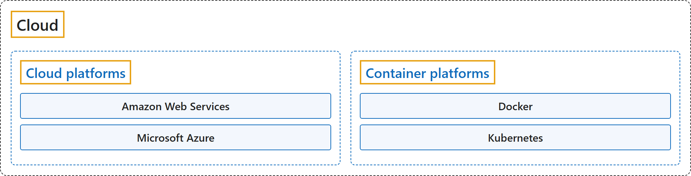

# Cloud

## Classification

## Glossary

| Term | Definition | 中文翻译 | Source |
|---|---|---|---|
| **Cloud** 云 | "**Cloud computing** is the **delivery of computing services** over the **internet**." | **云计算**是指**计算服务的交付**，通过**互联网**进行。 | [Microsoft, n.d.-a, "What is cloud computing" unit, para. 1](https://learn.microsoft.com/en-us/training/modules/describe-cloud-compute/3-what-cloud-compute#:~:text=Cloud%20computing%20is%20the%20delivery%20of%20computing%20services%20over%20the%20internet) |
| **Cloud platforms** 云平台 | "Azure is a **continually expanding set of cloud services** that help you **meet current and future IT challenges**." | Azure 是一组**不断扩展的云服务**，帮助你**应对当前和未来的 IT 挑战**。 | [Microsoft, n.d.-b, "What is Microsoft Azure" unit, para. 1](https://learn.microsoft.com/en-us/training/modules/describe-core-architectural-components-of-azure/2-what-microsoft-azure#:~:text=Azure%20is%20a%20continually%20expanding%20set%20of%20cloud%20services) |
| **Container platforms** 容器平台 | "Kubernetes is a **portable, extensible, open source platform** for **managing containerized workloads and services** that facilitate both **declarative configuration and automation**." | Kubernetes 是一个**可移植、可扩展的开源平台**，用于**管理容器化的工作负载和服务**，可促进**声明式配置和自动化**。 | [The Kubernetes Authors, n.d.-b, "Overview" page, para. 1](https://kubernetes.io/docs/concepts/overview/#:~:text=Kubernetes%20is%20a%20portable%2C%20extensible%2C%20open%20source%20platform) |

## Coverage

| Certification | Skill area |
|---|---|
| AZ-900 Microsoft Azure Fundamentals | [Describe cloud concepts (25–30%)](https://learn.microsoft.com/en-us/credentials/certifications/resources/study-guides/az-900#describe-cloud-concepts-2530) |
| AZ-900 Microsoft Azure Fundamentals | [Describe Azure architecture and services (35–40%)](https://learn.microsoft.com/en-us/credentials/certifications/resources/study-guides/az-900#describe-azure-architecture-and-services-3540) |
| AZ-900 Microsoft Azure Fundamentals | [Describe Azure management and governance (30–35%)](https://learn.microsoft.com/en-us/credentials/certifications/resources/study-guides/az-900#describe-azure-management-and-governance-3035) |

## References

Amazon Web Services. (n.d.). *AWS documentation*. Retrieved October 25, 2026, from <https://docs.aws.amazon.com/>

Docker Inc. (n.d.). *Get started*. Docker Docs. Retrieved October 25, 2026, from <https://docs.docker.com/get-started/>

Microsoft. (n.d.-a). *Microsoft Azure Fundamentals: Describe cloud concepts* [Learning path]. Microsoft Learn. Retrieved October 21, 2026, from <https://learn.microsoft.com/en-us/training/paths/microsoft-azure-fundamentals-describe-cloud-concepts/>

Microsoft. (n.d.-b). *Describe the core architectural components of Azure* [Module]. Microsoft Learn. Retrieved October 25, 2026, from <https://learn.microsoft.com/en-us/training/modules/describe-core-architectural-components-of-azure/>

Microsoft. (2026). *Study guide for Exam AZ-900: Microsoft Azure Fundamentals*. Microsoft Learn. <https://learn.microsoft.com/en-us/credentials/certifications/resources/study-guides/az-900>

The Kubernetes Authors. (n.d.-a). *Concepts*. Kubernetes Documentation. Retrieved October 25, 2026, from <https://kubernetes.io/docs/concepts/>

The Kubernetes Authors. (n.d.-b). *Overview*. Kubernetes Documentation. Retrieved October 25, 2026, from <https://kubernetes.io/docs/concepts/overview/>
