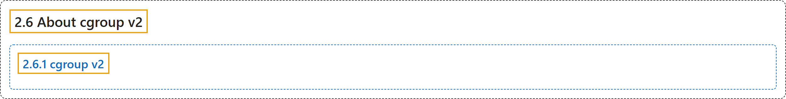

# 2.6 About cgroup v2

## Classification

## Glossary

| Term | Definition | 中文翻译 | Source |
|---|---|---|---|
| **2.6 About cgroup v2** 关于 cgroup v2 | (context) "On Linux, [control groups](https://kubernetes.io/docs/reference/glossary/?all=true#term-cgroup) **constrain resources that are allocated to processes**." | （语境）在 Linux 上，[控制组](https://kubernetes.io/docs/reference/glossary/?all=true#term-cgroup)**约束分配给进程的资源**。 | [The Kubernetes Authors, n.d., "About cgroup v2", para. 1](https://kubernetes.io/docs/concepts/architecture/cgroups/#:~:text=On%20Linux%2C%20%5Bcontrol%20groups%5D%28https%3A%2F%2Fkubernetes.io%2Fdocs%2Freference%2Fglossary%2F%3Fall%3Dtrue%23term-cgroup%29%20constrain%20resources%20that) |
| **2.6.1 cgroup v2** cgroup v2 | "cgroup v2 is **the next version of the Linux `cgroup` API**." | cgroup v2 是 **Linux `cgroup` API 的下一个版本**。 | [The Kubernetes Authors, n.d., "What is cgroup v2?", para. 1](https://kubernetes.io/docs/concepts/architecture/cgroups/#:~:text=cgroup%20v2%20is%20the%20next%20version%20of) |

## References

The Kubernetes Authors. (n.d.). *About cgroup v2*. Kubernetes Documentation. Retrieved October 31, 2026, from <https://kubernetes.io/docs/concepts/architecture/cgroups/>
