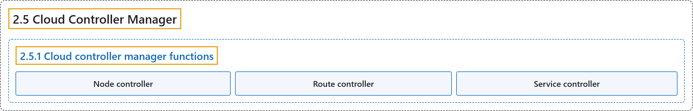

# 2.5 Cloud Controller Manager

## Classification

## Glossary

| Term | Definition | 中文翻译 | Source |
|---|---|---|---|
| **2.5 Cloud Controller Manager** 云控制器管理器 | "The cloud-controller-manager is **a Kubernetes [control plane](https://kubernetes.io/docs/reference/glossary/?all=true#term-control-plane) component that embeds cloud-specific control logic**." | 云控制器管理器是**一个嵌入了云平台特定控制逻辑的 Kubernetes [控制平面](https://kubernetes.io/docs/reference/glossary/?all=true#term-control-plane)组件**。 | [The Kubernetes Authors, n.d., "Cloud Controller Manager", para. 2](https://kubernetes.io/docs/concepts/architecture/cloud-controller/#:~:text=The%20cloud-controller-manager%20is%20a%20Kubernetes%20%5Bcontrol%20plane%5D%28https%3A%2F%2Fkubernetes.io%2Fdocs%2Freference%2Fglossary%2F%3Fall%3Dtrue%23term-control-plane%29) |
| **2.5.1 Cloud controller manager functions** 云控制器管理器的功能 | (context) "The controllers inside the cloud controller manager include:" | （语境）云控制器管理器中的控制器包括： | [The Kubernetes Authors, n.d., "Cloud controller manager functions", para. 1](https://kubernetes.io/docs/concepts/architecture/cloud-controller/#:~:text=The%20controllers%20inside%20the%20cloud%20controller%20manager) |
| **Node controller** 节点控制器 | "The node controller is **responsible for updating [Node](https://kubernetes.io/docs/concepts/architecture/nodes/) objects when new servers are created in your cloud infrastructure**." | 节点控制器**负责在云基础设施中创建新服务器时更新 [Node](https://kubernetes.io/docs/concepts/architecture/nodes/) 对象**。 | [The Kubernetes Authors, n.d., "Node controller", para. 1](https://kubernetes.io/docs/concepts/architecture/cloud-controller/#:~:text=The%20node%20controller%20is%20responsible%20for%20updating) |
| **Route controller** 路由控制器 | "The route controller is **responsible for configuring routes in the cloud appropriately so that containers on different nodes in your Kubernetes cluster can communicate with each other**." | 路由控制器**负责在云中正确配置路由，使 Kubernetes 集群中不同节点上的容器能够相互通信**。 | [The Kubernetes Authors, n.d., "Route controller", para. 1](https://kubernetes.io/docs/concepts/architecture/cloud-controller/#:~:text=The%20route%20controller%20is%20responsible%20for%20configuring) |
| **Service controller** 服务控制器 | "The service controller **interacts with your cloud provider's APIs to set up load balancers and other infrastructure components**" | 服务控制器**与云服务商的 API 交互，以设置负载均衡器和其他基础设施组件** | [The Kubernetes Authors, n.d., "Service controller", para. 1](https://kubernetes.io/docs/concepts/architecture/cloud-controller/#:~:text=The%20service%20controller%20interacts%20with%20your%20cloud) |

## References

The Kubernetes Authors. (n.d.). *Cloud Controller Manager*. Kubernetes Documentation. Retrieved October 31, 2026, from <https://kubernetes.io/docs/concepts/architecture/cloud-controller/>
