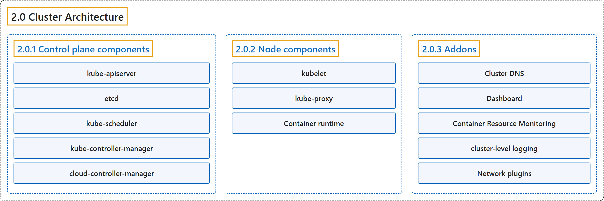

# 2.0 Cluster Architecture

## Classification

## Glossary

| Term | Definition | 中文翻译 | Source |
|---|---|---|---|
| **2.0 Cluster Architecture** 集群架构 | "A Kubernetes cluster consists of **a control plane** plus **a set of worker machines, called nodes**, that **run containerized applications**." | Kubernetes 集群由**一个控制平面**加上**一组称为节点的工作机器**组成，它们**运行容器化应用**。 | [The Kubernetes Authors, n.d., "Cluster Architecture", para. 2](https://kubernetes.io/docs/concepts/architecture/#:~:text=A%20Kubernetes%20cluster%20consists%20of%20a%20control) |
| **2.0.1 Control plane components** 控制平面组件 | "**The control plane's components** make **global decisions about the cluster** (for example, scheduling)" | **控制平面组件**对集群做出**全局决策**（例如调度） | [The Kubernetes Authors, n.d., "Control plane components", para. 1](https://kubernetes.io/docs/concepts/architecture/#:~:text=The%20control%20plane%27s%20components%20make%20global%20decisions) |
| **kube-apiserver** kube-apiserver | "The API server is **a component of the Kubernetes control plane** that **exposes the Kubernetes API**." | API 服务器是 **Kubernetes 控制平面的一个组件**，**暴露 Kubernetes API**。 | [The Kubernetes Authors, n.d., "kube-apiserver", para. 1](https://kubernetes.io/docs/concepts/architecture/#:~:text=The%20API%20server%20is%20a%20component%20of) |
| **etcd** etcd | "**Consistent and highly-available key value store** used as **Kubernetes' backing store for all cluster data**." | **一致且高可用的键值存储**，用作 **Kubernetes 所有集群数据的后备存储**。 | [The Kubernetes Authors, n.d., "etcd", para. 1](https://kubernetes.io/docs/concepts/architecture/#:~:text=Consistent%20and%20highly-available%20key%20value%20store%20used) |
| **kube-scheduler** kube-scheduler | "**Control plane component** that **watches for newly created Pods with no assigned node**, and **selects a node for them to run on**." | **控制平面组件**，**监视新创建且未分配节点的 Pod**，并**为它们选择运行的节点**。 | [The Kubernetes Authors, n.d., "kube-scheduler", para. 1](https://kubernetes.io/docs/concepts/architecture/#:~:text=Control%20plane%20component%20that%20watches%20for%20newly) |
| **kube-controller-manager** kube-controller-manager | "**Control plane component** that **runs controller processes**." | **控制平面组件**，**运行控制器进程**。 | [The Kubernetes Authors, n.d., "kube-controller-manager", para. 1](https://kubernetes.io/docs/concepts/architecture/#:~:text=Control%20plane%20component%20that%20runs%20%5Bcontroller%5D%28https%3A%2F%2Fkubernetes.io%2Fdocs%2Fconcepts%2Farchitecture%2Fcontroller%2F%29%20processes.) |
| **cloud-controller-manager** cloud-controller-manager | "**A Kubernetes control plane component** that **embeds cloud-specific control logic**." | **一个 Kubernetes 控制平面组件**，**嵌入了云平台特定的控制逻辑**。 | [The Kubernetes Authors, n.d., "cloud-controller-manager", para. 1](https://kubernetes.io/docs/concepts/architecture/#:~:text=A%20Kubernetes%20%5Bcontrol%20plane%5D%28https%3A%2F%2Fkubernetes.io%2Fdocs%2Freference%2Fglossary%2F%3Fall%3Dtrue%23term-control-plane%29%20component%20that%20embeds) |
| **2.0.2 Node components** 节点组件 | "Node components **run on every node**, **maintaining running pods** and **providing the Kubernetes runtime environment**." | 节点组件**在每个节点上运行**，**维护运行中的 Pod** 并**提供 Kubernetes 运行时环境**。 | [The Kubernetes Authors, n.d., "Node components", para. 1](https://kubernetes.io/docs/concepts/architecture/#:~:text=Node%20components%20run%20on%20every%20node%2C%20maintaining) |
| **kubelet** kubelet | "**An agent** that **runs on each node in the cluster**." | **一个代理**，**运行在集群中每个节点上**。 | [The Kubernetes Authors, n.d., "kubelet", para. 1](https://kubernetes.io/docs/concepts/architecture/#:~:text=An%20agent%20that%20runs%20on%20each%20%5Bnode%5D%28https%3A%2F%2Fkubernetes.io%2Fdocs%2Fconcepts%2Farchitecture%2Fnodes%2F%29) |
| **kube-proxy** kube-proxy | "kube-proxy is **a network proxy** that **runs on each node in your cluster**" | kube-proxy 是**一个网络代理**，**运行在集群中每个节点上** | [The Kubernetes Authors, n.d., "kube-proxy (optional)", para. 1](https://kubernetes.io/docs/concepts/architecture/#:~:text=kube-proxy%20is%20a%20network%20proxy%20that%20runs) |
| **Container runtime** 容器运行时 | "**A fundamental component** that **empowers Kubernetes to run containers effectively**." | **一个基础组件**，**让 Kubernetes 能够高效运行容器**。 | [The Kubernetes Authors, n.d., "Container runtime", para. 1](https://kubernetes.io/docs/concepts/architecture/#:~:text=A%20fundamental%20component%20that%20empowers%20Kubernetes%20to) |
| **2.0.3 Addons** 插件 | "**Addons use Kubernetes resources** (DaemonSet, Deployment, etc) to **implement cluster features**." | **插件使用 Kubernetes 资源**（DaemonSet、Deployment 等）来**实现集群功能**。 | [The Kubernetes Authors, n.d., "Addons", para. 1](https://kubernetes.io/docs/concepts/architecture/#:~:text=Addons%20use%20Kubernetes%20resources%20%28%5BDaemonSet%5D%28https%3A%2F%2Fkubernetes.io%2Fdocs%2Fconcepts%2Fworkloads%2Fcontrollers%2Fdaemonset%29%2C%20%5BDeployment%5D%28https%3A%2F%2Fkubernetes.io%2Fdocs%2Fconcepts%2Fworkloads%2Fcontrollers%2Fdeployment%2F%29%2C%20etc%29) |
| **Cluster DNS** 集群 DNS | "Cluster DNS is **a DNS server**, in addition to the other DNS server(s) in your environment, which **serves DNS records for Kubernetes services**." | 集群 DNS 是**一个 DNS 服务器**，独立于环境中的其他 DNS 服务器，**为 Kubernetes 服务提供 DNS 记录**。 | [The Kubernetes Authors, n.d., "DNS", para. 2](https://kubernetes.io/docs/concepts/architecture/#:~:text=Cluster%20DNS%20is%20a%20DNS%20server%2C%20in) |
| **Dashboard** 仪表板 | "Dashboard is **a general purpose, web-based UI** for **Kubernetes clusters**." | 仪表板是**一个通用的、基于 Web 的界面**，面向 **Kubernetes 集群**。 | [The Kubernetes Authors, n.d., "Web UI (Dashboard)", para. 1](https://kubernetes.io/docs/concepts/architecture/#:~:text=%5BDashboard%5D%28https%3A%2F%2Fkubernetes.io%2Fdocs%2Ftasks%2Faccess-application-cluster%2Fweb-ui-dashboard%2F%29%20is%20a%20general%20purpose%2C%20web-based%20UI) |
| **Container Resource Monitoring** 容器资源监控 | "Container Resource Monitoring **records generic time-series metrics about containers** in **a central database**, and **provides a UI for browsing that data**." | 容器资源监控**把容器的通用时间序列指标记录**到**中央数据库**中，并**提供浏览这些数据的界面**。 | [The Kubernetes Authors, n.d., "Container resource monitoring", para. 1](https://kubernetes.io/docs/concepts/architecture/#:~:text=%5BContainer%20Resource%20Monitoring%5D%28https%3A%2F%2Fkubernetes.io%2Fdocs%2Ftasks%2Fdebug%2Fdebug-cluster%2Fresource-usage-monitoring%2F%29%20records%20generic%20time-series%20metrics) |
| **cluster-level logging** 集群级日志 | "A cluster-level logging mechanism is responsible for **saving container logs** to **a central log store with a search/browsing interface**." | 集群级日志机制负责**把容器日志保存**到**带有搜索/浏览界面的中央日志存储**中。 | [The Kubernetes Authors, n.d., "Cluster-level Logging", para. 1](https://kubernetes.io/docs/concepts/architecture/#:~:text=A%20%5Bcluster-level%20logging%5D%28https%3A%2F%2Fkubernetes.io%2Fdocs%2Fconcepts%2Fcluster-administration%2Flogging%2F%29%20mechanism%20is%20responsible%20for) |
| **Network plugins** 网络插件 | "Network plugins are **software components** that **implement the container network interface (CNI) specification**." | 网络插件是**软件组件**，**实现容器网络接口（CNI）规范**。 | [The Kubernetes Authors, n.d., "Network plugins", para. 1](https://kubernetes.io/docs/concepts/architecture/#:~:text=%5BNetwork%20plugins%5D%28https%3A%2F%2Fkubernetes.io%2Fdocs%2Fconcepts%2Fextend-kubernetes%2Fcompute-storage-net%2Fnetwork-plugins%2F%29%20are%20software%20components%20that%20implement) |

## References

The Kubernetes Authors. (n.d.). *Cluster Architecture*. Kubernetes Documentation. Retrieved October 31, 2026, from <https://kubernetes.io/docs/concepts/architecture/>
