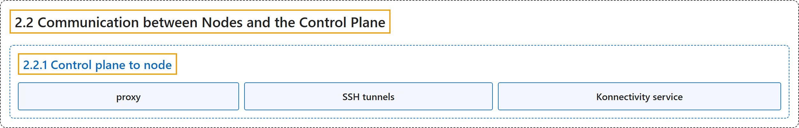

# 2.2 Communication between Nodes and the Control Plane

## Classification

## Glossary

| Term | Definition | 中文翻译 | Source |
|---|---|---|---|
| **2.2 Communication between Nodes and the Control Plane** 节点与控制平面之间的通信 | (context) "**Kubernetes** has a "**hub-and-spoke**" API **pattern**." | （语境）**Kubernetes** 采用“**中心辐射**”式的 API **模式**。 | [The Kubernetes Authors, n.d., "Node to Control Plane", para. 1](https://kubernetes.io/docs/concepts/architecture/control-plane-node-communication/#:~:text=Kubernetes%20has%20a%20%22hub-and-spoke%22%20API%20pattern.) |
| **2.2.1 Control plane to node** 控制平面到节点 | "There are **two primary communication paths** from **the control plane (the API server)** to **the nodes**." | 有**两条主要的通信路径**，从**控制平面**（API 服务器）到**节点**。 | [The Kubernetes Authors, n.d., "Control plane to node", para. 1](https://kubernetes.io/docs/concepts/architecture/control-plane-node-communication/#:~:text=There%20are%20two%20primary%20communication%20paths%20from) |
| **proxy** 代理 | (context) "The second is from **the API server to any node, pod, or service** through **the API server's *proxy* functionality**." | （语境）第二条是从 **API 服务器到任一节点、Pod 或服务**，经由 **API 服务器的*代理*功能**。 | [The Kubernetes Authors, n.d., "Control plane to node", para. 1](https://kubernetes.io/docs/concepts/architecture/control-plane-node-communication/#:~:text=The%20second%20is%20from%20the%20API%20server) |
| **SSH tunnels** SSH 隧道 | "Kubernetes supports **SSH tunnels** to **protect the control plane to nodes communication paths**." | Kubernetes 支持 **SSH 隧道**来**保护控制平面到节点的通信路径**。 | [The Kubernetes Authors, n.d., "SSH tunnels", para. 1](https://kubernetes.io/docs/concepts/architecture/control-plane-node-communication/#:~:text=Kubernetes%20supports%20%5BSSH%20tunnels%5D%28https%3A%2F%2Fwww.ssh.com%2Facademy%2Fssh%2Ftunneling%29%20to%20protect%20the) |
| **Konnectivity service** Konnectivity 服务 | "As a replacement to the SSH tunnels, **the Konnectivity service** provides **TCP level proxy** for **the control plane to cluster communication**." | 作为 SSH 隧道的替代，**Konnectivity 服务**提供 **TCP 层代理**，用于**控制平面到集群的通信**。 | [The Kubernetes Authors, n.d., "Konnectivity service", para. 1](https://kubernetes.io/docs/concepts/architecture/control-plane-node-communication/#:~:text=As%20a%20replacement%20to%20the%20SSH%20tunnels%2C) |

## References

The Kubernetes Authors. (n.d.). *Communication between Nodes and the Control Plane*. Kubernetes Documentation. Retrieved October 31, 2026, from <https://kubernetes.io/docs/concepts/architecture/control-plane-node-communication/>
