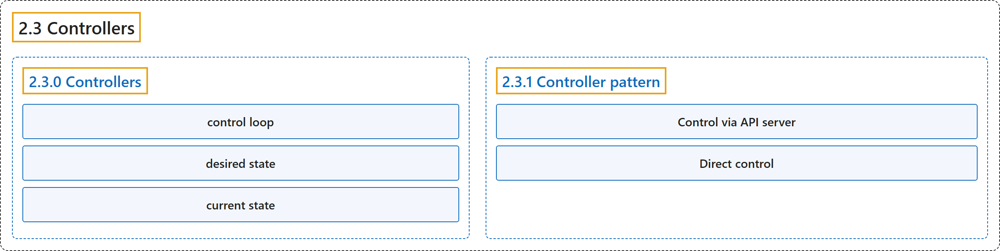

# 2.3 Controllers

## Classification

## Glossary

| Term | Definition | 中文翻译 | Source |
|---|---|---|---|
| **2.3 Controllers** 控制器 | (context) "In robotics and automation, a *control loop* is **a non-terminating loop that regulates the state of a system**." | （语境）在机器人和自动化领域，*控制回路*是**一个调节系统状态的非终止循环**。 | [The Kubernetes Authors, n.d., "Controllers", para. 1](https://kubernetes.io/docs/concepts/architecture/controller/#:~:text=In%20robotics%20and%20automation%2C%20a%20%2Acontrol%20loop%2A) |
| **2.3.0 Controllers** 控制器 | (No definition) | （无定义） | [The Kubernetes Authors, n.d., "Controllers"](https://kubernetes.io/docs/concepts/architecture/controller/#controllers) |
| **control loop** 控制回路 | "In robotics and automation, a *control loop* is **a non-terminating loop that regulates the state of a system**." | 在机器人和自动化领域，*控制回路*是**一个调节系统状态的非终止循环**。 | [The Kubernetes Authors, n.d., "Controllers", para. 1](https://kubernetes.io/docs/concepts/architecture/controller/#:~:text=In%20robotics%20and%20automation%2C%20a%20%2Acontrol%20loop%2A) |
| **desired state** 期望状态 | (context) "When you set the temperature, **that's telling the thermostat about your *desired state***." | （语境）当你设定温度时，**就是在告诉恒温器你的*期望状态***。 | [The Kubernetes Authors, n.d., "Controllers", para. 3](https://kubernetes.io/docs/concepts/architecture/controller/#:~:text=When%20you%20set%20the%20temperature%2C%20that%27s%20telling) |
| **current state** 当前状态 | (context) "**The actual room temperature is the *current state*.**" | （语境）**房间的实际温度就是*当前状态*。** | [The Kubernetes Authors, n.d., "Controllers", para. 3](https://kubernetes.io/docs/concepts/architecture/controller/#:~:text=The%20actual%20room%20temperature%20is%20the%20%2Acurrent) |
| **2.3.1 Controller pattern** 控制器模式 | "A controller **tracks at least one Kubernetes resource type**." | 控制器**至少跟踪一种 Kubernetes 资源类型**。 | [The Kubernetes Authors, n.d., "Controller pattern", para. 1](https://kubernetes.io/docs/concepts/architecture/controller/#:~:text=A%20controller%20tracks%20at%20least%20one%20Kubernetes) |
| **Control via API server** 通过 API 服务器控制 | "Built-in controllers **manage state by interacting with the cluster API server**." | 内置控制器**通过与集群 API 服务器交互来管理状态**。 | [The Kubernetes Authors, n.d., "Control via API server", para. 1](https://kubernetes.io/docs/concepts/architecture/controller/#:~:text=Built-in%20controllers%20manage%20state%20by%20interacting%20with) |
| **Direct control** 直接控制 | (context) "In contrast with Job, **some controllers need to make changes to things outside of your cluster**." | （语境）与 Job 不同，**有些控制器需要对集群之外的东西做出更改**。 | [The Kubernetes Authors, n.d., "Direct control", para. 1](https://kubernetes.io/docs/concepts/architecture/controller/#:~:text=In%20contrast%20with%20Job%2C%20some%20controllers%20need) |

## References

The Kubernetes Authors. (n.d.). *Controllers*. Kubernetes Documentation. Retrieved October 31, 2026, from <https://kubernetes.io/docs/concepts/architecture/controller/>
