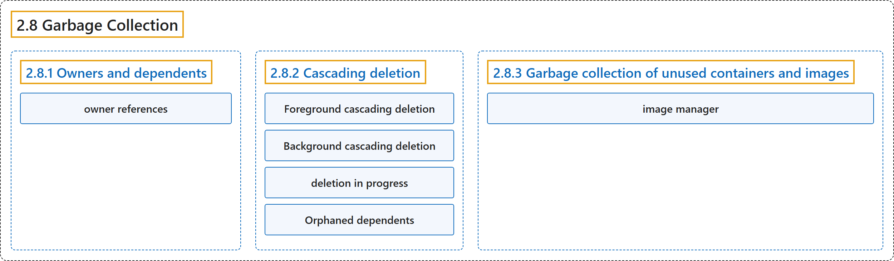

# 2.8 Garbage Collection

## Classification

## Glossary

| Term | Definition | 中文翻译 | Source |
|---|---|---|---|
| **2.8 Garbage Collection** 垃圾回收 | "Garbage collection is **a collective term for the various mechanisms Kubernetes uses to clean up cluster resources**." | 垃圾回收是**Kubernetes 用来清理集群资源的各种机制的统称**。 | [The Kubernetes Authors, n.d., "Garbage Collection", para. 1](https://kubernetes.io/docs/concepts/architecture/garbage-collection/#:~:text=Garbage%20collection%20is%20a%20collective%20term%20for) |
| **2.8.1 Owners and dependents** 属主与附属 | (No definition) | （无定义） | [The Kubernetes Authors, n.d., "Owners and dependents"](https://kubernetes.io/docs/concepts/architecture/garbage-collection/#owners-and-dependents) |
| **owner references** 属主引用 | "Owner references **tell the control plane which objects are dependent on others**." | 属主引用**告诉控制平面哪些对象依赖于其他对象**。 | [The Kubernetes Authors, n.d., "Owners and dependents", para. 1](https://kubernetes.io/docs/concepts/architecture/garbage-collection/#:~:text=Owner%20references%20tell%20the%20control%20plane%20which) |
| **2.8.2 Cascading deletion** 级联删除 | "When you delete an object, you can **control whether Kubernetes deletes the object's dependents automatically, in a process called *cascading deletion***." | 删除对象时，你可以**控制 Kubernetes 是否自动删除该对象的附属对象，这一过程称为*级联删除***。 | [The Kubernetes Authors, n.d., "Cascading deletion", para. 1](https://kubernetes.io/docs/concepts/architecture/garbage-collection/#:~:text=When%20you%20delete%20an%20object%2C%20you%20can) |
| **Foreground cascading deletion** 前台级联删除 | "In foreground cascading deletion, **the owner object you're deleting first enters a *deletion in progress* state**." | 在前台级联删除中，**你要删除的属主对象首先进入*删除进行中*状态**。 | [The Kubernetes Authors, n.d., "Foreground cascading deletion", para. 1](https://kubernetes.io/docs/concepts/architecture/garbage-collection/#:~:text=In%20foreground%20cascading%20deletion%2C%20the%20owner%20object) |
| **Background cascading deletion** 后台级联删除 | "In background cascading deletion, **the Kubernetes API server deletes the owner object immediately and the garbage collector controller (custom or default) cleans up the dependent objects in the background**." | 在后台级联删除中，**Kubernetes API 服务器立即删除属主对象，由垃圾回收控制器（自定义或默认的）在后台清理附属对象**。 | [The Kubernetes Authors, n.d., "Background cascading deletion", para. 1](https://kubernetes.io/docs/concepts/architecture/garbage-collection/#:~:text=In%20background%20cascading%20deletion%2C%20the%20Kubernetes%20API) |
| **deletion in progress** 删除进行中 | (context) "In foreground cascading deletion, the owner object you're deleting first enters **a *deletion in progress* state**." | （语境）在前台级联删除中，你要删除的属主对象首先进入**一种*删除进行中*状态**。 | [The Kubernetes Authors, n.d., "Foreground cascading deletion", para. 1](https://kubernetes.io/docs/concepts/architecture/garbage-collection/#:~:text=In%20foreground%20cascading%20deletion%2C%20the%20owner%20object) |
| **Orphaned dependents** 孤立的附属对象 | "When Kubernetes deletes an owner object, **the dependents left behind are called *orphan* objects**." | 当 Kubernetes 删除属主对象时，**留下的附属对象称为*孤儿*对象**。 | [The Kubernetes Authors, n.d., "Orphaned dependents", para. 1](https://kubernetes.io/docs/concepts/architecture/garbage-collection/#:~:text=When%20Kubernetes%20deletes%20an%20owner%20object%2C%20the) |
| **2.8.3 Garbage collection of unused containers and images** 未使用容器和镜像的垃圾回收 | "The [kubelet](https://kubernetes.io/docs/reference/command-line-tools-reference/kubelet) **performs garbage collection on unused images every five minutes and on unused containers every minute**." | [kubelet](https://kubernetes.io/docs/reference/command-line-tools-reference/kubelet) **每五分钟对未使用的镜像、每分钟对未使用的容器执行一次垃圾回收**。 | [The Kubernetes Authors, n.d., "Garbage collection of unused containers and images", para. 1](https://kubernetes.io/docs/concepts/architecture/garbage-collection/#:~:text=The%20%5Bkubelet%5D%28https%3A%2F%2Fkubernetes.io%2Fdocs%2Freference%2Fcommand-line-tools-reference%2Fkubelet%29%20performs%20garbage%20collection%20on%20unused) |
| **image manager** 镜像管理器 | "Kubernetes manages the lifecycle of all images through its *image manager*, **which is part of the kubelet**, with the cooperation of [cadvisor](https://github.com/google/cadvisor/)." | Kubernetes 通过其*镜像管理器*管理所有镜像的生命周期，**镜像管理器是 kubelet 的一部分**，并与 [cadvisor](https://github.com/google/cadvisor/) 协作。 | [The Kubernetes Authors, n.d., "Container image lifecycle", para. 1](https://kubernetes.io/docs/concepts/architecture/garbage-collection/#:~:text=Kubernetes%20manages%20the%20lifecycle%20of%20all%20images) |

## References

The Kubernetes Authors. (n.d.). *Garbage Collection*. Kubernetes Documentation. Retrieved October 31, 2026, from <https://kubernetes.io/docs/concepts/architecture/garbage-collection/>
