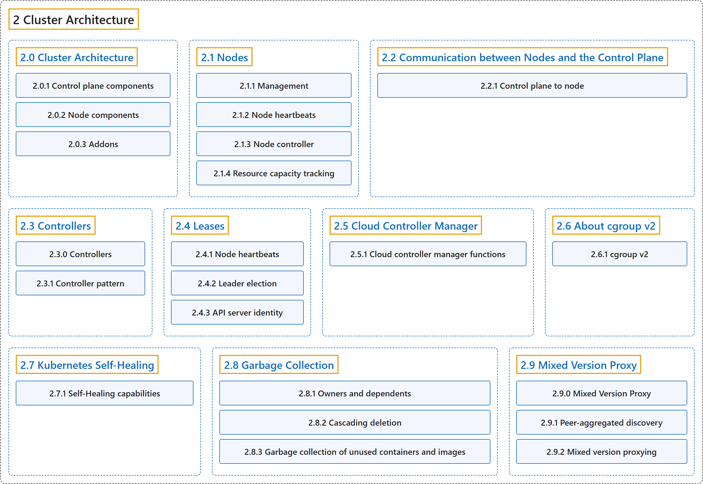

# 2 Cluster Architecture

## Classification

## Glossary

| Term | Definition | 中文翻译 | Source |
|---|---|---|---|
| **2 Cluster Architecture** 集群架构 | (context) "**The architectural concepts behind Kubernetes.**" | （语境）**Kubernetes 背后的架构概念。** | [The Kubernetes Authors, n.d.-c, "Cluster Architecture", para. 1](https://kubernetes.io/docs/concepts/architecture/#:~:text=The%20architectural%20concepts%20behind%20Kubernetes.) |
| **[2.0 Cluster Architecture](cluster-architecture.md)** 集群架构 | "A Kubernetes cluster consists of **a control plane plus a set of worker machines, called nodes, that run containerized applications**." | Kubernetes 集群由**一个控制平面加上一组运行容器化应用的工作机器（称为节点）**组成。 | [The Kubernetes Authors, n.d.-c, "Cluster Architecture", para. 2](https://kubernetes.io/docs/concepts/architecture/#:~:text=A%20Kubernetes%20cluster%20consists%20of%20a%20control) |
| **[2.1 Nodes](nodes.md)** 节点 | "A node **may be a virtual or physical machine, depending on the cluster**." | 节点**可以是虚拟机或物理机，取决于集群**。 | [The Kubernetes Authors, n.d.-j, "Nodes", para. 1](https://kubernetes.io/docs/concepts/architecture/nodes/#:~:text=A%20node%20may%20be%20a%20virtual%20or) |
| **[2.2 Communication between Nodes and the Control Plane](control-plane-node-communication.md)** 节点与控制平面之间的通信 | (context) "Kubernetes has **a "hub-and-spoke" API pattern**." | （语境）Kubernetes 采用**“中心辐射”式的 API 模式**。 | [The Kubernetes Authors, n.d.-d, "Node to Control Plane", para. 1](https://kubernetes.io/docs/concepts/architecture/control-plane-node-communication/#:~:text=Kubernetes%20has%20a%20%22hub-and-spoke%22%20API%20pattern.) |
| **[2.3 Controllers](controller.md)** 控制器 | (context) "In robotics and automation, a *control loop* is **a non-terminating loop that regulates the state of a system**." | （语境）在机器人和自动化领域，*控制回路*是**一个调节系统状态的非终止循环**。 | [The Kubernetes Authors, n.d.-e, "Controllers", para. 1](https://kubernetes.io/docs/concepts/architecture/controller/#:~:text=In%20robotics%20and%20automation%2C%20a%20%2Acontrol%20loop%2A) |
| **[2.4 Leases](leases.md)** 租约 | "Distributed systems often have a need for *leases*, which **provide a mechanism to lock shared resources and coordinate activity between members of a set**." | 分布式系统常常需要*租约*，它**提供一种机制来锁定共享资源，并协调一组成员之间的活动**。 | [The Kubernetes Authors, n.d.-h, "Leases", para. 1](https://kubernetes.io/docs/concepts/architecture/leases/#:~:text=Distributed%20systems%20often%20have%20a%20need%20for) |
| **[2.5 Cloud Controller Manager](cloud-controller.md)** 云控制器管理器 | "The cloud-controller-manager is **a Kubernetes [control plane](https://kubernetes.io/docs/reference/glossary/?all=true#term-control-plane) component that embeds cloud-specific control logic**." | 云控制器管理器是**一个嵌入了云平台特定控制逻辑的 Kubernetes [控制平面](https://kubernetes.io/docs/reference/glossary/?all=true#term-control-plane)组件**。 | [The Kubernetes Authors, n.d.-b, "Cloud Controller Manager", para. 2](https://kubernetes.io/docs/concepts/architecture/cloud-controller/#:~:text=The%20cloud-controller-manager%20is%20a%20Kubernetes%20%5Bcontrol%20plane%5D%28https%3A%2F%2Fkubernetes.io%2Fdocs%2Freference%2Fglossary%2F%3Fall%3Dtrue%23term-control-plane%29) |
| **[2.6 About cgroup v2](cgroups.md)** 关于 cgroup v2 | (context) "On Linux, [control groups](https://kubernetes.io/docs/reference/glossary/?all=true#term-cgroup) **constrain resources that are allocated to processes**." | （语境）在 Linux 上，[控制组](https://kubernetes.io/docs/reference/glossary/?all=true#term-cgroup)**约束分配给进程的资源**。 | [The Kubernetes Authors, n.d.-a, "About cgroup v2", para. 1](https://kubernetes.io/docs/concepts/architecture/cgroups/#:~:text=On%20Linux%2C%20%5Bcontrol%20groups%5D%28https%3A%2F%2Fkubernetes.io%2Fdocs%2Freference%2Fglossary%2F%3Fall%3Dtrue%23term-cgroup%29%20constrain%20resources%20that) |
| **[2.7 Kubernetes Self-Healing](self-healing.md)** Kubernetes 自我修复 | "Kubernetes is designed with **self-healing capabilities that help maintain the health and availability of workloads**." | Kubernetes 设计有**自我修复能力，帮助维持工作负载的健康和可用性**。 | [The Kubernetes Authors, n.d.-g, "Kubernetes Self-Healing", para. 1](https://kubernetes.io/docs/concepts/architecture/self-healing/#:~:text=Kubernetes%20is%20designed%20with%20self-healing%20capabilities%20that) |
| **[2.8 Garbage Collection](garbage-collection.md)** 垃圾回收 | "Garbage collection is **a collective term for the various mechanisms Kubernetes uses to clean up cluster resources**." | 垃圾回收是**Kubernetes 用来清理集群资源的各种机制的统称**。 | [The Kubernetes Authors, n.d.-f, "Garbage Collection", para. 1](https://kubernetes.io/docs/concepts/architecture/garbage-collection/#:~:text=Garbage%20collection%20is%20a%20collective%20term%20for) |
| **[2.9 Mixed Version Proxy](mixed-version-proxy.md)** 混合版本代理 | "Kubernetes 1.37 includes a beta feature that **lets an [API Server](https://kubernetes.io/docs/concepts/architecture/#kube-apiserver) proxy resource requests to other *peer* API servers**." | Kubernetes 1.37 包含一项 beta 功能，**让一个 [API 服务器](https://kubernetes.io/docs/concepts/architecture/#kube-apiserver)把资源请求代理给其他*对等* API 服务器**。 | [The Kubernetes Authors, n.d.-i, "Mixed Version Proxy", para. 1](https://kubernetes.io/docs/concepts/architecture/mixed-version-proxy/#:~:text=Kubernetes%201.37%20includes%20a%20beta%20feature%20that) |

## References

The Kubernetes Authors. (n.d.-a). *About cgroup v2*. Kubernetes Documentation. Retrieved October 31, 2026, from <https://kubernetes.io/docs/concepts/architecture/cgroups/>

The Kubernetes Authors. (n.d.-b). *Cloud Controller Manager*. Kubernetes Documentation. Retrieved October 31, 2026, from <https://kubernetes.io/docs/concepts/architecture/cloud-controller/>

The Kubernetes Authors. (n.d.-c). *Cluster Architecture*. Kubernetes Documentation. Retrieved October 31, 2026, from <https://kubernetes.io/docs/concepts/architecture/>

The Kubernetes Authors. (n.d.-d). *Communication between Nodes and the Control Plane*. Kubernetes Documentation. Retrieved October 31, 2026, from <https://kubernetes.io/docs/concepts/architecture/control-plane-node-communication/>

The Kubernetes Authors. (n.d.-e). *Controllers*. Kubernetes Documentation. Retrieved October 31, 2026, from <https://kubernetes.io/docs/concepts/architecture/controller/>

The Kubernetes Authors. (n.d.-f). *Garbage Collection*. Kubernetes Documentation. Retrieved October 31, 2026, from <https://kubernetes.io/docs/concepts/architecture/garbage-collection/>

The Kubernetes Authors. (n.d.-g). *Kubernetes Self-Healing*. Kubernetes Documentation. Retrieved October 31, 2026, from <https://kubernetes.io/docs/concepts/architecture/self-healing/>

The Kubernetes Authors. (n.d.-h). *Leases*. Kubernetes Documentation. Retrieved October 31, 2026, from <https://kubernetes.io/docs/concepts/architecture/leases/>

The Kubernetes Authors. (n.d.-i). *Mixed Version Proxy*. Kubernetes Documentation. Retrieved October 31, 2026, from <https://kubernetes.io/docs/concepts/architecture/mixed-version-proxy/>

The Kubernetes Authors. (n.d.-j). *Nodes*. Kubernetes Documentation. Retrieved October 31, 2026, from <https://kubernetes.io/docs/concepts/architecture/nodes/>
