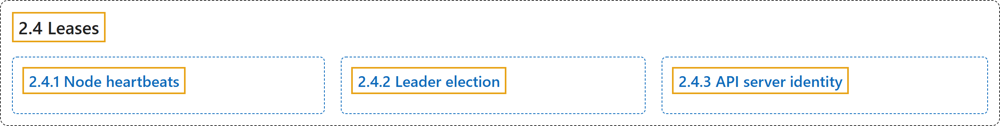

# 2.4 Leases

## Classification

## Glossary

| Term | Definition | 中文翻译 | Source |
|---|---|---|---|
| **2.4 Leases** 租约 | "Distributed systems often have a need for *leases*, which **provide a mechanism to lock shared resources and coordinate activity between members of a set**." | 分布式系统常常需要*租约*，它**提供一种机制来锁定共享资源，并协调一组成员之间的活动**。 | [The Kubernetes Authors, n.d., "Leases", para. 1](https://kubernetes.io/docs/concepts/architecture/leases/#:~:text=Distributed%20systems%20often%20have%20a%20need%20for) |
| **2.4.1 Node heartbeats** 节点心跳 | "Kubernetes uses the Lease API to **communicate kubelet node heartbeats to the Kubernetes API server**." | Kubernetes 使用 Lease API **把 kubelet 的节点心跳传达给 Kubernetes API 服务器**。 | [The Kubernetes Authors, n.d., "Node heartbeats", para. 1](https://kubernetes.io/docs/concepts/architecture/leases/#:~:text=Kubernetes%20uses%20the%20Lease%20API%20to%20communicate) |
| **2.4.2 Leader election** 领导者选举 | "Kubernetes also uses Leases to **ensure only one instance of a component is running at any given time**." | Kubernetes 还使用租约来**确保任一时刻只有一个组件实例在运行**。 | [The Kubernetes Authors, n.d., "Leader election", para. 1](https://kubernetes.io/docs/concepts/architecture/leases/#:~:text=Kubernetes%20also%20uses%20Leases%20to%20ensure%20only) |
| **2.4.3 API server identity** API 服务器身份 | "Starting in Kubernetes v1.26, each `kube-apiserver` **uses the Lease API to publish its identity to the rest of the system**." | 从 Kubernetes v1.26 开始，每个 `kube-apiserver` **使用 Lease API 向系统其余部分发布自己的身份**。 | [The Kubernetes Authors, n.d., "API server identity", para. 1](https://kubernetes.io/docs/concepts/architecture/leases/#:~:text=Starting%20in%20Kubernetes%20v1.26%2C%20each%20%60kube-apiserver%60%20uses) |

## References

The Kubernetes Authors. (n.d.). *Leases*. Kubernetes Documentation. Retrieved October 31, 2026, from <https://kubernetes.io/docs/concepts/architecture/leases/>
