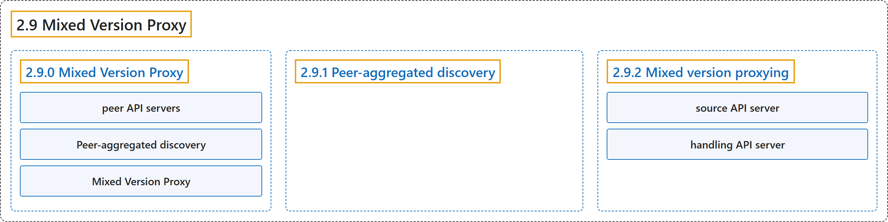

# 2.9 Mixed Version Proxy

## Classification

## Glossary

| Term | Definition | 中文翻译 | Source |
|---|---|---|---|
| **2.9 Mixed Version Proxy** 混合版本代理 | "Kubernetes 1.37 includes a beta feature that lets an API Server **proxy resource requests** to **other *peer* API servers**." | Kubernetes 1.37 包含一项 beta 功能，让一个 API 服务器**把资源请求代理**给**其他*对等* API 服务器**。 | [The Kubernetes Authors, n.d., "Mixed Version Proxy", para. 1](https://kubernetes.io/docs/concepts/architecture/mixed-version-proxy/#:~:text=Kubernetes%201.37%20includes%20a%20beta%20feature%20that) |
| **2.9.0 Mixed Version Proxy** 混合版本代理 | (No definition) | （无定义） | [The Kubernetes Authors, n.d., "Mixed Version Proxy"](https://kubernetes.io/docs/concepts/architecture/mixed-version-proxy/#mixed-version-proxy) |
| **peer API servers** 对等 API 服务器 | (context) "Kubernetes 1.37 includes a beta feature that lets an API Server **proxy resource requests** to **other *peer* API servers**." | （语境）Kubernetes 1.37 包含一项 beta 功能，让一个 API 服务器**把资源请求代理**给**其他*对等* API 服务器**。 | [The Kubernetes Authors, n.d., "Mixed Version Proxy", para. 1](https://kubernetes.io/docs/concepts/architecture/mixed-version-proxy/#:~:text=Kubernetes%201.37%20includes%20a%20beta%20feature%20that) |
| **Peer-aggregated discovery** 对等聚合发现 | "We call **this complete cluster-wide** discovery ***Peer-aggregated discovery***." | 我们把**这种完整的集群范围**发现称为***对等聚合发现***。 | [The Kubernetes Authors, n.d., "Mixed Version Proxy", para. 3](https://kubernetes.io/docs/concepts/architecture/mixed-version-proxy/#:~:text=We%20call%20this%20complete%20cluster-wide%20discovery%20%2APeer-aggregated) |
| **Mixed Version Proxy** 混合版本代理 | (context) "This mechanism is called the *Mixed Version Proxy*." | （语境）这一机制称为*混合版本代理*。 | [The Kubernetes Authors, n.d., "Mixed Version Proxy", para. 4](https://kubernetes.io/docs/concepts/architecture/mixed-version-proxy/#:~:text=This%20mechanism%20is%20called%20the%20%2AMixed%20Version) |
| **2.9.1 Peer-aggregated discovery** 对等聚合发现 | "When you enable the feature, **discovery requests are automatically enabled** to serve **a comprehensive discovery document** (listing **all resources served by any apiserver in the cluster**) by default." | 启用该功能后，**发现请求会自动启用**，默认提供**一份完整的发现文档**（列出**集群中任一 API 服务器提供的全部资源**）。 | [The Kubernetes Authors, n.d., "Peer-aggregated discovery", para. 1](https://kubernetes.io/docs/concepts/architecture/mixed-version-proxy/#:~:text=When%20you%20enable%20the%20feature%2C%20discovery%20requests) |
| **2.9.2 Mixed version proxying** 混合版本代理 | "When you enable **mixed version proxying**, the **aggregation layer** loads **a special filter** that does the following:" | 启用**混合版本代理**后，**聚合层**会加载**一个特殊的过滤器**，执行以下操作： | [The Kubernetes Authors, n.d., "Mixed version proxying", para. 1](https://kubernetes.io/docs/concepts/architecture/mixed-version-proxy/#:~:text=When%20you%20enable%20mixed%20version%20proxying%2C%20the) |
| **source API server** 源 API 服务器 | (context) "If **the peer API server fails to respond**, the ***source* API server** responds with **503** ("Service Unavailable") error." | （语境）如果**对等 API 服务器没有响应**，由***源* API 服务器**返回 **503**（“Service Unavailable”）错误。 | [The Kubernetes Authors, n.d., "Mixed version proxying", para. 3](https://kubernetes.io/docs/concepts/architecture/mixed-version-proxy/#:~:text=If%20the%20peer%20API%20server%20fails%20to) |
| **handling API server** 处理请求的 API 服务器 | "the API server **trying to handle the request** (the ***handling API server***)" | **尝试处理该请求**的 API 服务器（即***处理请求的 API 服务器***） | [The Kubernetes Authors, n.d., "How it works under the hood", para. 3](https://kubernetes.io/docs/concepts/architecture/mixed-version-proxy/#:~:text=the%20API%20server%20trying%20to%20handle%20the) |

## References

The Kubernetes Authors. (n.d.). *Mixed Version Proxy*. Kubernetes Documentation. Retrieved October 31, 2026, from <https://kubernetes.io/docs/concepts/architecture/mixed-version-proxy/>
