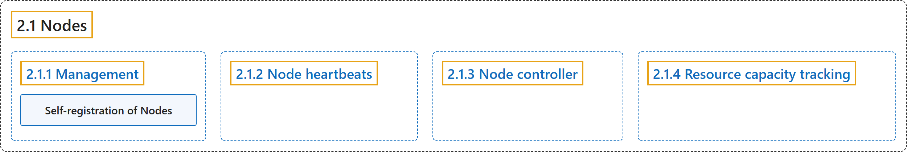

# 2.1 Nodes

## Classification

## Glossary

| Term | Definition | 中文翻译 | Source |
|---|---|---|---|
| **2.1 Nodes** 节点 | "A node may be **a virtual or physical machine**, **depending on the cluster**." | 节点可以是**虚拟机或物理机**，**取决于集群**。 | [The Kubernetes Authors, n.d., "Nodes", para. 1](https://kubernetes.io/docs/concepts/architecture/nodes/#:~:text=A%20node%20may%20be%20a%20virtual%20or) |
| **2.1.1 Management** 管理 | (context) "There are **two main ways** to have **Nodes added to the API server**:" | （语境）有**两种主要方式**把**节点添加到 API 服务器**： | [The Kubernetes Authors, n.d., "Management", para. 1](https://kubernetes.io/docs/concepts/architecture/nodes/#:~:text=There%20are%20two%20main%20ways%20to%20have) |
| **Self-registration of Nodes** 节点自注册 | "When **the kubelet** flag `--register-node` is true (the default), the kubelet will attempt to **register itself with the API server**." | 当 kubelet 标志 `--register-node` 为 true（默认值）时，**kubelet** 会尝试**向 API 服务器注册自己**。 | [The Kubernetes Authors, n.d., "Self-registration of Nodes", para. 1](https://kubernetes.io/docs/concepts/architecture/nodes/#:~:text=When%20the%20kubelet%20flag%20%60--register-node%60%20is%20true) |
| **2.1.2 Node heartbeats** 节点心跳 | "**Heartbeats**, sent by Kubernetes nodes, help your cluster **determine the availability of each node**, and to **take action when failures are detected**." | **心跳**由 Kubernetes 节点发送，帮助集群**判断每个节点的可用性**，并**在检测到故障时采取行动**。 | [The Kubernetes Authors, n.d., "Node heartbeats", para. 1](https://kubernetes.io/docs/concepts/architecture/nodes/#:~:text=Heartbeats%2C%20sent%20by%20Kubernetes%20nodes%2C%20help%20your) |
| **2.1.3 Node controller** 节点控制器 | "The node controller is **a Kubernetes control plane component** that **manages various aspects of nodes**." | 节点控制器是**一个 Kubernetes 控制平面组件**，**管理节点的各个方面**。 | [The Kubernetes Authors, n.d., "Node controller", para. 1](https://kubernetes.io/docs/concepts/architecture/nodes/#:~:text=The%20node%20%5Bcontroller%5D%28https%3A%2F%2Fkubernetes.io%2Fdocs%2Fconcepts%2Farchitecture%2Fcontroller%2F%29%20is%20a%20Kubernetes%20control) |
| **2.1.4 Resource capacity tracking** 资源容量跟踪 | "**Node objects** track **information about the Node's resource capacity**: for example, the amount of memory available and the number of CPUs." | **Node 对象**跟踪**节点资源容量的信息**：例如可用内存量和 CPU 数量。 | [The Kubernetes Authors, n.d., "Resource capacity tracking", para. 1](https://kubernetes.io/docs/concepts/architecture/nodes/#:~:text=Node%20objects%20track%20information%20about%20the%20Node%27s) |

## References

The Kubernetes Authors. (n.d.). *Nodes*. Kubernetes Documentation. Retrieved October 31, 2026, from <https://kubernetes.io/docs/concepts/architecture/nodes/>
