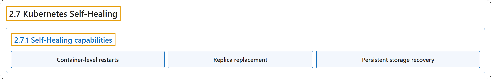

# 2.7 Kubernetes Self-Healing

## Classification

## Glossary

| Term | Definition | 中文翻译 | Source |
|---|---|---|---|
| **2.7 Kubernetes Self-Healing** Kubernetes 自我修复 | "Kubernetes is designed with **self-healing capabilities** that help **maintain the health and availability of workloads**." | Kubernetes 设计有**自我修复能力**，帮助**维持工作负载的健康和可用性**。 | [The Kubernetes Authors, n.d., "Kubernetes Self-Healing", para. 1](https://kubernetes.io/docs/concepts/architecture/self-healing/#:~:text=Kubernetes%20is%20designed%20with%20self-healing%20capabilities%20that) |
| **2.7.1 Self-Healing capabilities** 自我修复能力 | (No definition) | （无定义） | [The Kubernetes Authors, n.d., "Self-Healing capabilities"](https://kubernetes.io/docs/concepts/architecture/self-healing/#self-healing-capabilities) |
| **Container-level restarts** 容器级重启 | "If **a container inside a Pod fails**, **Kubernetes restarts it** based on the restartPolicy." | 如果 **Pod 内的容器失败**，**Kubernetes 会重启它**，依据是 restartPolicy。 | [The Kubernetes Authors, n.d., "Self-Healing capabilities", para. 1](https://kubernetes.io/docs/concepts/architecture/self-healing/#:~:text=If%20a%20container%20inside%20a%20Pod%20fails%2C) |
| **Replica replacement** 副本替换 | "If a Pod in a Deployment or StatefulSet fails, **Kubernetes creates a replacement Pod** to **maintain the specified number of replicas**." | 如果 Deployment 或 StatefulSet 中的 Pod 失败，**Kubernetes 会创建一个替代 Pod** 以**维持指定的副本数**。 | [The Kubernetes Authors, n.d., "Self-Healing capabilities", para. 2](https://kubernetes.io/docs/concepts/architecture/self-healing/#:~:text=If%20a%20Pod%20in%20a%20%5BDeployment%5D%28https%3A%2F%2Fkubernetes.io%2Fdocs%2Fconcepts%2Fworkloads%2Fcontrollers%2Fdeployment%2F%29%20or) |
| **Persistent storage recovery** 持久存储恢复 | "If a node is running a Pod with a PersistentVolume (PV) attached, and **the node fails**, Kubernetes can **reattach the volume to a new Pod on a different node**." | 如果某节点上运行着挂接了 PersistentVolume（PV）的 Pod，而**该节点失败**，Kubernetes 可以**把卷重新挂接到另一个节点上的新 Pod**。 | [The Kubernetes Authors, n.d., "Self-Healing capabilities", para. 3](https://kubernetes.io/docs/concepts/architecture/self-healing/#:~:text=If%20a%20node%20is%20running%20a%20Pod) |

## References

The Kubernetes Authors. (n.d.). *Kubernetes Self-Healing*. Kubernetes Documentation. Retrieved October 31, 2026, from <https://kubernetes.io/docs/concepts/architecture/self-healing/>
