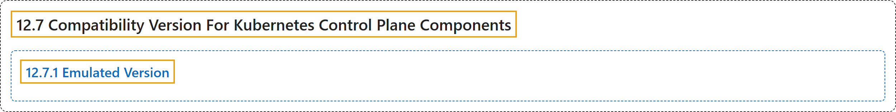

# 12.7 Compatibility Version For Kubernetes Control Plane Components

## Classification

## Glossary

| Term | Definition | 中文翻译 | Source |
|---|---|---|---|
| **12.7 Compatibility Version For Kubernetes Control Plane Components** Kubernetes 控制平面组件的兼容版本 | (context) "Since release v1.32, we introduced **configurable version compatibility and emulation options** to **Kubernetes control plane components** to **make upgrades safer** by providing more control and increasing the granularity of steps available to cluster administrators." | （语境）自 v1.32 版本起，我们引入了**可配置的版本兼容和模拟选项**，用于 **Kubernetes 控制平面组件**，以**让升级更安全**：提供更多控制，细化集群管理员可用的步骤。 | [The Kubernetes Authors, n.d., "Compatibility Version For Kubernetes Control Plane Components", para. 1](https://kubernetes.io/docs/concepts/cluster-administration/compatibility-version/#:~:text=Since%20release%20v1.32%2C%20we%20introduced%20configurable%20version) |
| **12.7.1 Emulated Version** 模拟版本 | "**The emulation option** is **set by the `--emulated-version` flag** of control plane components." | **模拟选项**由控制平面组件的 **`--emulated-version` 标志设置**。 | [The Kubernetes Authors, n.d., "Emulated Version", para. 1](https://kubernetes.io/docs/concepts/cluster-administration/compatibility-version/#:~:text=The%20emulation%20option%20is%20set%20by%20the) |

## References

The Kubernetes Authors. (n.d.). *Compatibility Version For Kubernetes Control Plane Components*. Kubernetes Documentation. Retrieved October 31, 2026, from <https://kubernetes.io/docs/concepts/cluster-administration/compatibility-version/>
