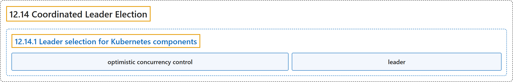

# 12.14 Coordinated Leader Election

## Classification

## Glossary

| Term | Definition | 中文翻译 | Source |
|---|---|---|---|
| **12.14 Coordinated Leader Election** 协调式领导者选举 | "Kubernetes 1.37 includes a beta feature that **allows [control plane](https://kubernetes.io/docs/reference/glossary/?all=true#term-control-plane) components to deterministically select a leader via *coordinated leader election***." | Kubernetes 1.37 包含一项 beta 功能，**允许[控制平面](https://kubernetes.io/docs/reference/glossary/?all=true#term-control-plane)组件通过*协调式领导者选举*确定性地选出领导者**。 | [The Kubernetes Authors, n.d., "Coordinated Leader Election", para. 3](https://kubernetes.io/docs/concepts/cluster-administration/coordinated-leader-election/#:~:text=Kubernetes%201.37%20includes%20a%20beta%20feature%20that) |
| **12.14.1 Leader selection for Kubernetes components** Kubernetes 组件的领导者选择 | (No definition) | （无定义） | [The Kubernetes Authors, n.d., "Leader selection for Kubernetes components"](https://kubernetes.io/docs/concepts/cluster-administration/coordinated-leader-election/#leader-selection-for-kubernetes-components) |
| **optimistic concurrency control** 乐观并发控制 | "Kubernetes relies on ***optimistic concurrency control* via the object's `resourceVersion`**: only one update succeeds due to version mismatch on concurrent attempts." | Kubernetes 依靠**通过对象的 `resourceVersion` 实现的*乐观并发控制***：并发尝试时由于版本不匹配，只有一次更新会成功。 | [The Kubernetes Authors, n.d., "Leader selection for Kubernetes components", para. 15](https://kubernetes.io/docs/concepts/cluster-administration/coordinated-leader-election/#:~:text=Kubernetes%20relies%20on%20%2Aoptimistic%20concurrency%20control%2A%20via) |
| **leader** 领导者 | "The instance whose update is accepted **becomes the *leader***." | 更新被接受的那个实例**成为*领导者***。 | [The Kubernetes Authors, n.d., "Leader selection for Kubernetes components", para. 15](https://kubernetes.io/docs/concepts/cluster-administration/coordinated-leader-election/#:~:text=The%20instance%20whose%20update%20is%20accepted%20becomes) |

## References

The Kubernetes Authors. (n.d.). *Coordinated Leader Election*. Kubernetes Documentation. Retrieved October 31, 2026, from <https://kubernetes.io/docs/concepts/cluster-administration/coordinated-leader-election/>
